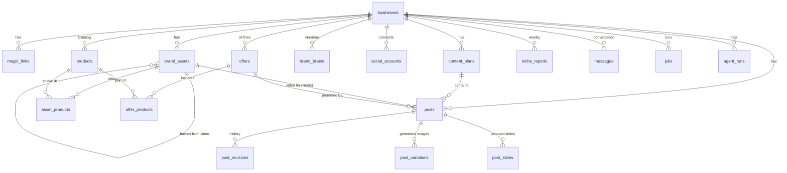

# Data model

Postgres on Supabase ([ADR 0003](../decisions/0003-database-supabase-sqlalchemy.md)). The schema below is the **initial Alembic migration** (`backend/migrations/versions/0001_initial.py`, executing this SQL). After that, every change is a new migration; never edit an applied one.

Conventions follow [`.claude/rules/database.md`](../../.claude/rules/database.md): explicitly named constraints and indexes (`uq_`, `ck_`, `ix_`, `{table}_{col}_fkey`), every FK column indexed (or covered by a composite index or unique constraint that starts with it), `timestamptz` everywhere, enum-like values as `text` + `check`, JSON in `jsonb`. Primary keys are UUIDs rather than identity integers, because IDs travel in WhatsApp button payloads and URLs (see the ADR).

## Entity overview



## Schema

```sql
create extension if not exists pgcrypto;

-- One row per Business (= one Owner phone number in the MVP)
create table businesses (
  id                 uuid primary key default gen_random_uuid(),
  owner_phone        text not null,                  -- E.164 without '+', as WhatsApp sends it: "59899123456"
  owner_name         text,                           -- WhatsApp profile name
  name               text,
  category           text,
  one_liner          text,
  description        text,
  location           text,
  website            text,
  instagram_handle   text,
  timezone           text not null default 'America/Montevideo',
  onboarding_state   text not null default 'new',
  onboarding_data    jsonb not null default '{}',    -- raw wizard answers: questionnaire, 3 words, colors (products live in `products`)
  conversation_state jsonb not null default '{}',    -- {"awaiting": "post_feedback", "post_id": "..."}
  conversation_summary text,                         -- the orchestrator's summary of the steps compacted out of conversation_steps (ADR 0028, migration 0002)
  channel            text not null default 'whatsapp',
  plan               text not null default 'free',   -- future billing
  monthly_post_quota int  not null default 30,       -- future billing, not enforced
  created_at         timestamptz not null default now(),
  updated_at         timestamptz not null default now(),
  constraint uq_businesses_owner_phone unique (owner_phone),
  constraint ck_businesses_onboarding_state check (onboarding_state in
    ('new','awaiting_name','awaiting_web_form','generating_brand','awaiting_brand_confirmation','active')),
  constraint ck_businesses_channel check (channel in ('whatsapp','simulator')),
  constraint ck_businesses_monthly_post_quota_non_negative check (monthly_post_quota >= 0)
);

create table magic_links (
  id           uuid primary key default gen_random_uuid(),
  business_id  uuid not null constraint magic_links_business_id_fkey references businesses(id) on delete cascade,
  token_hash   text not null,                         -- sha256(token); the raw token only lives in the URL
  purpose      text not null default 'onboarding',
  expires_at   timestamptz not null,                  -- dashboard links (editable): 7 days
  completed_at timestamptz,
  created_at   timestamptz not null default now(),
  constraint uq_magic_links_token_hash unique (token_hash),
  constraint ck_magic_links_purpose check (purpose in ('onboarding','dashboard'))
);
create index ix_magic_links_business_id on magic_links (business_id);

-- The Catalog: everything the Business sells
create table products (
  id           uuid primary key default gen_random_uuid(),
  business_id  uuid not null constraint products_business_id_fkey references businesses(id) on delete cascade,
  name         text not null,
  description  text not null default '',           -- variants ("viene en 3 medidas") go here as free text
  price        text,                                 -- as the Owner wrote it: "$U 4.500", "desde 12.000"
  category     text,
  position     int  not null default 0,              -- Owner's order in the dashboard
  archived_at  timestamptz,                          -- archived = hidden from agents and the dashboard; never hard-deleted
  created_at   timestamptz not null default now(),
  updated_at   timestamptz not null default now()
);
create index ix_products_business_id_active on products (business_id) where archived_at is null;

create table brand_assets (
  id                     uuid primary key default gen_random_uuid(),
  business_id            uuid not null constraint brand_assets_business_id_fkey references businesses(id) on delete cascade,
  kind                   text not null,
  source                 text not null,
  status                 text not null default 'uploading',
  storage_path           text not null,             -- in bucket 'assets'
  mime_type              text not null,
  size_bytes             bigint,
  width                  int,
  height                 int,
  duration_ms            int,                       -- videos only
  derived_from_asset_id  uuid constraint brand_assets_derived_from_asset_id_fkey
                           references brand_assets(id) on delete cascade,  -- a frame saved from a video
  frame_offset_ms        int,                       -- where in that video the frame was taken
  owner_hint             text,                      -- optional label from the Owner
  analysis               jsonb,                     -- AssetAnalysis (photo, logo) or VideoAnalysis (video); null until analyzed
  palette                jsonb,                     -- ["#2f3e2c", ...] (logos, Pillow)
  archived_at            timestamptz,
  created_at             timestamptz not null default now(),
  constraint ck_brand_assets_kind check (kind in ('logo','photo','video')),
  constraint ck_brand_assets_source check (source in ('web','whatsapp','instagram')),  -- 'instagram': feed import (F2.8, Could)
  constraint ck_brand_assets_status check (status in ('uploading','ready','failed')),
  constraint ck_brand_assets_duration_only_video check (duration_ms is null or kind = 'video'),
  constraint ck_brand_assets_frame_has_source check (
    (derived_from_asset_id is null) = (frame_offset_ms is null))
);
create index ix_brand_assets_business_id_kind on brand_assets (business_id, kind);
create index ix_brand_assets_derived_from_asset_id on brand_assets (derived_from_asset_id);

-- Which Products a Brand asset shows (a living-room photo can show the sofa, the table and the rug)
create table asset_products (
  asset_id    uuid not null constraint asset_products_asset_id_fkey references brand_assets(id) on delete cascade,
  product_id  uuid not null constraint asset_products_product_id_fkey references products(id) on delete cascade,
  source      text not null,                        -- 'analyst' suggested it, or the 'owner' set it
  created_at  timestamptz not null default now(),
  constraint pk_asset_products primary key (asset_id, product_id),
  constraint ck_asset_products_source check (source in ('analyst','owner'))
);
create index ix_asset_products_product_id on asset_products (product_id);

-- Packs and promos. Only the Owner defines conditions; the Agency never invents prices
create table offers (
  id           uuid primary key default gen_random_uuid(),
  business_id  uuid not null constraint offers_business_id_fkey references businesses(id) on delete cascade,
  kind         text not null,
  title        text not null,
  conditions   text not null,                       -- "10% off pagando en efectivo, hasta el domingo"
  price        text,                                -- as the Owner wrote it
  starts_on    date,
  ends_on      date,
  status       text not null default 'draft',
  created_at   timestamptz not null default now(),
  updated_at   timestamptz not null default now(),
  constraint ck_offers_kind check (kind in ('pack','promo')),
  constraint ck_offers_status check (status in ('draft','active','archived')),
  constraint ck_offers_dates_ordered check (starts_on is null or ends_on is null or starts_on <= ends_on)
);
create index ix_offers_business_id_status on offers (business_id, status);

create table offer_products (
  offer_id    uuid not null constraint offer_products_offer_id_fkey references offers(id) on delete cascade,
  product_id  uuid not null constraint offer_products_product_id_fkey references products(id) on delete cascade,
  constraint pk_offer_products primary key (offer_id, product_id)
);
create index ix_offer_products_product_id on offer_products (product_id);

create table brand_brains (
  id           uuid primary key default gen_random_uuid(),
  business_id  uuid not null constraint brand_brains_business_id_fkey references businesses(id) on delete cascade,
  version      int  not null,
  data         jsonb not null,                        -- BrandBrain
  reason       text not null,
  created_at   timestamptz not null default now(),
  constraint uq_brand_brains_business_id_version unique (business_id, version),
  constraint ck_brand_brains_reason check (reason in ('onboarding','correction','chat_update')),
  constraint ck_brand_brains_version_positive check (version > 0)
);

create table social_accounts (
  id                   uuid primary key default gen_random_uuid(),
  business_id          uuid not null constraint social_accounts_business_id_fkey references businesses(id) on delete cascade,
  platform             text not null,
  provider             text not null,                 -- 'mock' | 'zernio'
  provider_profile_id  text,                          -- the provider's id for this Business
  provider_account_id  text,                          -- the provider's id for the connected IG account
  handle               text,
  status               text not null default 'pending',
  created_at           timestamptz not null default now(),
  updated_at           timestamptz not null default now(),
  constraint uq_social_accounts_business_id_platform unique (business_id, platform),
  constraint ck_social_accounts_platform check (platform in ('instagram','facebook')),
  constraint ck_social_accounts_status check (status in ('pending','connected','error'))
);

create table content_plans (
  id           uuid primary key default gen_random_uuid(),
  business_id  uuid not null constraint content_plans_business_id_fkey references businesses(id) on delete cascade,
  week_start   date not null,
  status       text not null default 'generating',
  data         jsonb,                                 -- WeeklyPlan (items + whatsapp_text)
  notes        text,
  created_at   timestamptz not null default now(),
  updated_at   timestamptz not null default now(),
  constraint ck_content_plans_status check (status in
    ('generating','pending_approval','revising','approved','failed'))
);
create index ix_content_plans_business_id_week_start on content_plans (business_id, week_start);

-- Weekly Niche Report (Should, ADR 0025): what works in the Business's niche, from grounded web search
create table niche_reports (
  id           uuid primary key default gen_random_uuid(),
  business_id  uuid not null references businesses(id) on delete cascade,
  week_start   date not null,                  -- Monday, in the Business's timezone
  report       jsonb not null,                 -- NicheReport (agents.md § Niche Analyst)
  created_at   timestamptz not null default now(),
  unique (business_id, week_start)
);

create table posts (
  id                uuid primary key default gen_random_uuid(),
  business_id       uuid not null constraint posts_business_id_fkey references businesses(id) on delete cascade,
  plan_id           uuid constraint posts_plan_id_fkey references content_plans(id) on delete set null,
  plan_item_index   int,
  origin            text not null,
  format            text not null default 'image',
  platform          text not null default 'instagram',
  brief             text not null,                    -- plan item idea or Owner request
  status            text not null default 'generating',
  title             text,
  copy              jsonb,                            -- PostCopy, or CarouselCopy for carousels (ADR 0022)
  image_brief       jsonb,                            -- ImageBrief (Art Director): reference photos + image prompt; CarouselBrief for carousels
  candidate_asset_ids uuid[] not null default '{}',  -- photos the Owner sent with the request; preferred references for the Art Director
  reference_asset_ids uuid[] not null default '{}',  -- photos sent to the image service (ImageBrief.reference_asset_ids)
  video_asset_id    uuid constraint posts_video_asset_id_fkey references brand_assets(id) on delete set null,  -- Reels
  cover_offset_ms   int,                              -- Reel cover frame
  offer_id          uuid constraint posts_offer_id_fkey references offers(id) on delete set null,
  variation_n       int,                              -- picked variation of the current revision; null until the Owner picks
  image_path        text,                             -- in bucket 'renders': the picked variation (image Posts)
  image_url         text,                             -- public URL of the picked variation (image Posts)
  revision          int  not null default 0,
  scheduled_for     timestamptz,
  approved_at       timestamptz,
  published_at      timestamptz,
  external_post_id  text,                             -- provider post id
  permalink         text,
  error             text,
  created_at        timestamptz not null default now(),
  updated_at        timestamptz not null default now(),
  constraint ck_posts_origin check (origin in ('plan','adhoc','photo')),
  constraint ck_posts_format check (format in ('image','reel','carousel')),
  -- video_asset_id is "on delete set null", but assets are only ever archived, so a Reel keeps its video
  constraint ck_posts_reel_has_video check (format <> 'reel' or video_asset_id is not null),
  constraint ck_posts_platform check (platform in ('instagram','facebook')),
  constraint ck_posts_status check (status in ('generating','pending_approval','revising','approved',
    'publishing','scheduled','published','failed','discarded')),
  constraint ck_posts_revision_non_negative check (revision >= 0),
  -- approval is enforced in code too, but no writer may mark a post published or scheduled without it
  constraint ck_posts_approved_before_publish check (
    status not in ('publishing','scheduled','published') or approved_at is not null)
);
create index ix_posts_business_id_status on posts (business_id, status);
create index ix_posts_plan_id on posts (plan_id);
create index ix_posts_video_asset_id on posts (video_asset_id);
create index ix_posts_offer_id on posts (offer_id);

create table post_revisions (
  id           uuid primary key default gen_random_uuid(),
  post_id      uuid not null constraint post_revisions_post_id_fkey references posts(id) on delete cascade,
  revision     int  not null,
  feedback     text,
  target       text,
  copy         jsonb,
  image_brief  jsonb,
  image_url    text,                                  -- the variation picked at this revision
  video_asset_id  uuid,                               -- Reels: the video and cover at this revision (history only, no FK)
  cover_offset_ms int,
  created_at   timestamptz not null default now(),
  constraint uq_post_revisions_post_id_revision unique (post_id, revision),
  constraint ck_post_revisions_target check (target in ('copy','image','both','cover','video','slides'))
);

-- Images generated for an image Post (ADR 0018); the Owner picks one per revision
create table post_variations (
  id           uuid primary key default gen_random_uuid(),
  post_id      uuid not null constraint post_variations_post_id_fkey references posts(id) on delete cascade,
  revision     int  not null,                         -- posts.revision when generated
  n            int  not null,                         -- 1-based number shown to the Owner
  image_path   text not null,                         -- in bucket 'renders', resized to 1080x1350
  image_url    text not null,
  provider     text not null,                         -- gemini | openai | mock
  model        text,
  created_at   timestamptz not null default now(),
  constraint uq_post_variations_post_id_revision_n unique (post_id, revision, n),
  constraint ck_post_variations_n_positive check (n >= 1)
);

-- Slides of a carousel Post (ADR 0022); a slide redo bumps posts.revision and copies the unchanged rows
create table post_slides (
  id           uuid primary key default gen_random_uuid(),
  post_id      uuid not null constraint post_slides_post_id_fkey references posts(id) on delete cascade,
  revision     int  not null,
  idx          int  not null,                         -- 1-based slide position
  role         text not null,
  text         jsonb not null,                        -- SlideCopy
  prompt       text not null,
  image_path   text not null,                         -- in bucket 'renders', 1080x1350
  image_url    text not null,
  provider     text not null,
  model        text,
  text_check   jsonb,                                 -- TextCheck, null when not checked
  created_at   timestamptz not null default now(),
  constraint uq_post_slides_post_id_revision_idx unique (post_id, revision, idx),
  constraint ck_post_slides_idx_range check (idx between 1 and 10),
  constraint ck_post_slides_role check (role in ('cover','content','cta'))
);

create table messages (
  id              uuid primary key default gen_random_uuid(),
  business_id     uuid not null constraint messages_business_id_fkey references businesses(id) on delete cascade,
  direction       text not null,
  channel         text not null,
  external_id     text,                               -- wa_message_id (dedupe key for inbound)
  type            text not null,                      -- text | image | interactive | button_reply | audio | ...
  text            text,                               -- normalized text used in the LLM history
  payload         jsonb not null default '{}',        -- raw content (buttons, media ids, image url); audio: media_id, mime_type, byte_size, transcript_source
  status          text,                               -- outbound: sent | delivered | read | failed
  created_at      timestamptz not null default now(),
  constraint uq_messages_external_id unique (external_id),
  constraint ck_messages_direction check (direction in ('in','out')),
  constraint ck_messages_channel check (channel in ('whatsapp','simulator'))
);
create index ix_messages_business_id_created_at on messages (business_id, created_at desc);

-- The orchestrator's history, one Interactions API step per row, resent unchanged (ADR 0028, migration 0002)
create table conversation_steps (
  id           bigint generated always as identity primary key,
  business_id  uuid not null constraint conversation_steps_business_id_fkey references businesses(id) on delete cascade,
  step         jsonb not null,
  created_at   timestamptz not null default now()
);
create index ix_conversation_steps_business_id_id on conversation_steps (business_id, id);

-- Facts and standing preferences the Owner asked the orchestrator to keep (ADR 0028, migration 0002)
create table owner_notes (
  id           uuid primary key default gen_random_uuid(),
  business_id  uuid not null constraint owner_notes_business_id_fkey references businesses(id) on delete cascade,
  text         text not null,
  created_at   timestamptz not null default now(),
  archived_at  timestamptz,
  constraint ck_owner_notes_text_not_blank check (length(trim(text)) > 0)
);
create index ix_owner_notes_business_id on owner_notes (business_id) where archived_at is null;

create table jobs (
  id           uuid primary key default gen_random_uuid(),
  business_id  uuid constraint jobs_business_id_fkey references businesses(id) on delete cascade,
  kind         text not null,
  payload      jsonb not null default '{}',
  status       text not null default 'queued',
  result       jsonb,
  error        text,
  started_at   timestamptz,
  finished_at  timestamptz,
  created_at   timestamptz not null default now(),
  constraint ck_jobs_kind check (kind in ('analyze_asset','generate_brand','generate_plan',
    'generate_post','revise_post','redo_slides','publish_post')),
  constraint ck_jobs_status check (status in ('queued','running','succeeded','failed'))
);
create index ix_jobs_business_id on jobs (business_id);
create index ix_jobs_status_created_at on jobs (status, created_at);

create table agent_runs (
  id                uuid primary key default gen_random_uuid(),
  business_id       uuid constraint agent_runs_business_id_fkey references businesses(id) on delete cascade,
  job_id            uuid constraint agent_runs_job_id_fkey references jobs(id) on delete set null,
  agent             text not null,                    -- orchestrator | asset_analyst | brand_strategist | ... | image_gen (provider usage, for cost per variation) | transcribe (Gemini voice notes)
  model             text not null,
  effort            text,
  input             jsonb,
  output            jsonb,
  stop_reason       text,
  input_tokens      int,
  output_tokens     int,
  cache_read_tokens int,
  latency_ms        int,
  error             text,
  created_at        timestamptz not null default now()
);
create index ix_agent_runs_business_id_created_at on agent_runs (business_id, created_at desc);
create index ix_agent_runs_job_id on agent_runs (job_id);
```

`updated_at` is set by the application on update (no triggers).

## Notes

- **Phone number = identity** in the MVP. Multi-user businesses later need `users` + `business_members`; nothing else in the schema assumes one owner except `businesses.owner_phone`.
- **Simulator businesses** use fake phone numbers prefixed `sim-` and `channel = 'simulator'`, so the outbound channel is chosen per business.
- **Row Level Security**: off for the hackathon (the backend uses the service role key and is the only DB client). Turn RLS on before any client talks to Supabase directly. Browser uploads don't break this rule: the browser only writes to Storage, through a signed upload URL the backend issues for one path ([ADR 0012](../decisions/0012-catalog-content-dashboard-reels.md)).
- **Products and Offers**: the Catalog lives in `products`, not in `onboarding_data` or the Brand Brain. The Brand Brain keeps only a featured summary that references product ids; agents read the full Catalog and the `active` Offers (not past `ends_on`) from these tables. `current_offers` no longer exists.
- **Archiving, not deleting**: Owners archive Products, Brand assets and Offers (`archived_at`, or `status = 'archived'` for Offers). Archived rows are hidden from agents and the dashboard. Published and scheduled Posts keep their generated image or video; draft Posts (`pending_approval`, `revising`) that use archived material are flagged for review.
- **Variations**: `generate_post` writes one `post_variations` row per generated image; picking one copies its path and URL to `posts.image_path` / `image_url` and sets `variation_n`. Approval ([ADR 0007](../decisions/0007-approve-every-post.md)) applies to the picked variation; for an image Post the publisher only ever reads `posts.image_url`. Image-service cost is logged in `agent_runs` with `agent = 'image_gen'`.
- **Carousel slides** ([ADR 0022](../decisions/0022-carousels-in-mvp.md)): a carousel (`posts.format = 'carousel'`) has no Variations and leaves `posts.image_path` / `image_url` / `variation_n` null. `generate_post` writes one `post_slides` row per slide at `posts.revision`; `redo_slides` bumps the revision, writes the redone slides and copies the unchanged rows, so each revision is a complete carousel. The publisher reads the current revision's rows in `idx` order. Images are stored at `renders/{business_id}/{post_id}-r{revision}-s{idx}.jpg`. `text_check` keeps the Text Checker's result; a slide that still fails after its one regeneration is kept with `matches = false`.
- **Video frames**: the Asset Analyst saves the best frames of a video as `photo` assets with `derived_from_asset_id` and `frame_offset_ms` set, so the Art Director can use them like any photo.
- **Build priority** ([ADR 0016](../decisions/0016-demo-scope-one-post.md)): the first migration creates the whole schema, including the Catalog, Offer, video and Reel columns from [ADR 0012](../decisions/0012-catalog-content-dashboard-reels.md), because a column costs nothing and a later migration mid-hackathon does. The Must scope only writes businesses, magic links, photos and logos (wizard and chat), Brand Brains, ad-hoc posts and the conversation tables; `products` holds the 1–5 wizard Products. The rest stays empty until its Could feature is built.
- **The orchestrator's memory** ([ADR 0028](../decisions/0028-orchestrator-memory-and-context.md)): `conversation_steps` holds the model's own history (thought signatures included), which `messages` can't: `messages` is the normalized log of what crossed the channel. Old steps are deleted once folded into `businesses.conversation_summary`. Chat photos become `brand_assets` rows with `source = 'whatsapp'` and the Asset Analyst's `analysis`.
- **Seed**: `backend/app/db/seed.py` creates the demo business with a pre-generated Brand Brain and plan (see the demo fallbacks in [../product/mvp.md](../product/mvp.md#demo-fallbacks)).
