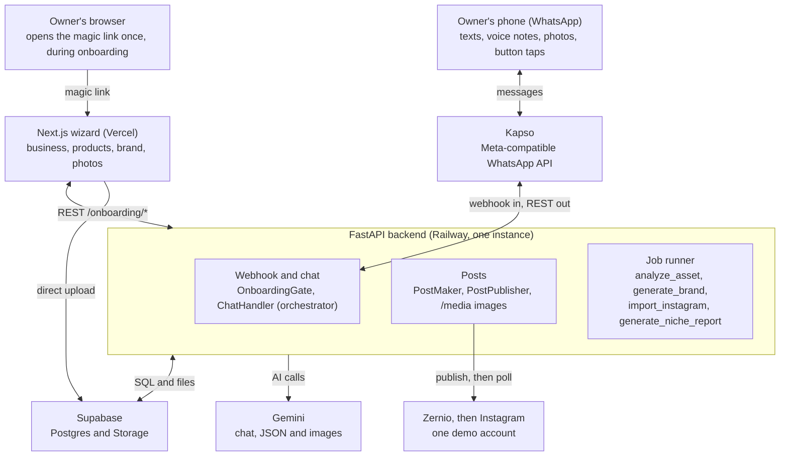

# How the system fits together

As of 2026-10-28. This describes the code on `main`; [overview.md](overview.md), [integrations.md](integrations.md) and [agents.md](agents.md) describe the intended design and may be ahead of it.

## Big picture

One FastAPI backend sits in the middle and talks to four outside services: Kapso for WhatsApp, Gemini for every AI call, Zernio for Instagram, and Supabase for the database and file storage. The Owner reaches it through WhatsApp, plus a Next.js web wizard opened from a magic link during onboarding.

Each outside service sits behind a small interface (a Python `Protocol`, called a port). A factory picks the real adapter or a mock from env vars, so the rest of the code never knows which one is running.

| Port | Real adapter | Mock or alternative | Env var |
|---|---|---|---|
| `ChannelPort` (WhatsApp) | `channels/kapso.py` | `echo` handler, no LLM | `WHATSAPP_CHANNEL`, `INBOUND_HANDLER` |
| `ChatModel` (text LLM) | `llm/client.py`, Gemini | none | `GEMINI_CHAT_MODEL` |
| `ImageGenPort` | `imagegen/gemini.py` | `imagegen/mock.py` | `IMAGE_GEN` |
| `PublisherPort` (Instagram) | `publishing/zernio.py` | `publishing/mock.py` | `PUBLISHER` |

Everything is wired together in [`backend/app/conversation/factory.py`](../../backend/app/conversation/factory.py) (`build_conversation` reads `Settings`; `build_chat` is the one place the chat graph is wired, in production and in tests; it returns the inbound `handler` and the `notify` that jobs share). It is the best first file to read. The webhook's `get_conversation()` in `channels/router.py` puts the `handler` behind a `RateLimitedHandler` (a token bucket per sender, [#106](https://github.com/guidodinello/build101/issues/106)), and that behind a `PilotGate` (`pilot.py`, the pilot list, [#186](https://github.com/guidodinello/build101/issues/186)); `notify` is not limited, since code raises those events, not the Owner.

## WhatsApp and the backend, through Kapso

We never call Meta directly: Kapso sits in between and exposes a Meta-compatible WhatsApp API ([ADR 0020](../decisions/0020-whatsapp-via-kapso.md)). Kapso pushes messages to us by webhook, and we call Kapso's REST API to reply.

**Inbound, Owner to us** (`channels/router.py`, `POST /webhooks/whatsapp`):

1. Kapso POSTs the message. The body is capped at 256 KiB before anything else.
2. The `X-Webhook-Signature` header is checked: an HMAC-SHA256 of the raw body with `KAPSO_WEBHOOK_SECRET`. A bad signature gets a 401.
3. Events other than `whatsapp.message.received` get a 200 and are ignored. A 4xx would make Kapso retry.
4. `kapso_webhook.py` turns the payload into an `InboundMessage` of kind text, button, image, audio, album or other. Voice notes arrive already transcribed by Kapso.
5. Duplicates are dropped by WhatsApp message id: in the `inbound_deliveries` table with the database, in memory without it.
6. The backend answers 200 at once and handles the message in a background task, so Kapso never waits for the AI.

**Outbound, us to Owner** (`channels/kapso.py`): `KapsoChannel` POSTs to `{KAPSO_BASE_URL}/{phone_number_id}/messages` with an `X-API-Key` header. It can send text, an image by URL, up to 3 reply buttons, mark a message read (which also shows the typing indicator), and download media the Owner sent.

**Images go out as links, not uploads.** Generated JPEGs are kept in memory by `PublicImages` (`media/public.py`) and served at `/media/<random token>.jpg`. WhatsApp, and later Zernio, fetch them from `PUBLIC_BACKEND_URL`, which is why that setting is required. In local dev it is your tunnel URL.

## What happens to a message

Every inbound message passes through two handlers in a row: `OnboardingGate`, which is plain code, and then `ChatHandler`, which is the AI. In front of both, `PilotGate` (`pilot.py`) answers a number not on the pilot list with the `waitlist` reply, at most once a day, and stops it there; the pilot list is `PILOT_SENDERS` plus the `pilot_senders` table, read at most once a minute ([setup.md § Pilot numbers](../implementation/setup.md#pilot-numbers)).

**`OnboardingGate`** (`conversation/onboarding.py`) looks up the Business by the Owner's phone number in Postgres, then acts on its onboarding state:

- `new`: sends the welcome and asks for the business name.
- `awaiting_name`: saves the name and sends a magic link to the web wizard.
- `awaiting_web_form`: resends a fresh link, at most once every 30 s.
- Any later state: hands the message to `ChatHandler`.

The states and the moves between them live in one module, `onboarding/state.py`: an enum plus a transition function per move (`welcome`, `name_received`, `form_submitted`, `confirm_brand`, ...). The gate, the web API, the `generate_brand` job and the brand buttons ask it to move the Business and never write `onboarding_state` themselves.

**`ChatHandler`** (`conversation/chat.py`) routes each kind of message and holds the Owner's lock; the work is in three modules it calls: `PhotoBatches` (`photo_batches.py`, the photo debounce), `Turns` (`turns.py`, one orchestrator turn) and `Toolbox` (`toolbox.py`, the tools). It treats each kind of message differently:

- **Photos** are downloaded, resized, and held in a 5-second batch, because WhatsApp sends an album as one message per photo. The batch is answered when the timer fires, or together with a text that arrives meanwhile.
- **Text and voice notes** start an LLM turn. A voice note is handled as its Kapso transcript.
- **Button taps** go to `ButtonRouter` (`conversation/button_router.py`), which acts in code (approve, discard, publish, retry) and returns an event.
- **Anything else** (stickers, stale buttons, unreadable photos) also becomes an event.

A lock per Owner (`history.lock(sender)`) makes sure one Owner's turns never overlap. A turn slower than 20 s sends a holding message ("ya te digo") and keeps the typing indicator on.

## The backend and the AI models

Every model call goes to Gemini, for text ([ADR 0023](../decisions/0023-gemini-text-llm.md)) and for images ([ADR 0019](../decisions/0019-image-provider-gemini.md)). We run our own orchestration loop rather than an agent framework.

**The client** (`llm/client.py`): `GeminiChat` calls Gemini's Interactions API in stateless mode (`store=False`). We keep each Owner's conversation history ourselves and resend it on every turn. It has two methods:

- `reply(...)`: a chat turn that returns text or tool calls.
- `structured(...)`: returns JSON validated against a Pydantic schema.

Timeouts are 60 s for chat and 90 s for structured calls. Server errors are retried; 429 (quota) is not, because the SDK would wait for hours. Each call logs its tokens under an `agent=` name.

**The agents** are each a prompt plus one call to that client:

| Agent | Where | Call | What it does |
|---|---|---|---|
| orchestrator | `conversation/turns.py` | `reply` with tools | Talks with the Owner; decides when to call its tools (below) |
| post_drafter | `posts/drafts.py` | `structured` | Brief, photos and Brand Brain become caption, hashtags and, for a design, each slide's headline and scene prompt |
| asset_analyst | `agents/asset_analyst.py` | `structured` | Analyzes each photo uploaded in the wizard (background job) and each photo the Owner sends in the chat (`PhotoKeeper`), both through `assets/analysis.py` |
| brand_strategist | `agents/brand_strategist.py` | `structured`, high thinking | Writes the Brand Brain: voice, audience, pillars, visual identity (background job) |
| niche_analyst | `agents/niche_analyst.py` | `grounded` (URL context and Google Search) | Writes the weekly Niche Report of a niche: what its stores and articles show this week, each point with a checked source (background job) |
| image generation | `imagegen/gemini.py`, `carousel/generator.py` | `generate_content` | Makes 4:5 slide images from scene prompts and the product photos |

**The orchestrator's tool loop** (`turns.py`, `_converse`; Owner turns and event turns share one pipeline, `_run`): for up to 5 steps, send the system prompt, the history and the current message with the tools. If Gemini answers with text, that text goes to WhatsApp. If it asks for a tool, code runs it, appends the result, and loops. Tools are declared in `conversation/tools.py` and run by `Toolbox` (`toolbox.py`):

| Tool | What it does |
|---|---|
| `create_post` | Starts a Post from the Owner's photos, as they are or as a design |
| `revise_post` | Remakes a Post the Owner already got, changing only what they asked |
| `approve_post` | Publishes a Post, only if the Owner's own words approve it (below) |
| `list_posts` | The Owner's Posts and their status |
| `remember` | Saves an Owner note |
| `forget` | Drops an Owner note |
| `update_brand` | Changes the Brand Brain |
| `create_video` | Makes a Reel from a Post's product photo; declared only when `VIDEO_GEN_ENABLED` is on ([ADR 0033](../decisions/0033-ai-generated-reels-veo.md)) |

Tools that act on the Owner's words (all but `approve_post` and `list_posts`) are refused in an event turn. The ones that make something return at once (`{"post_id": ..., "status": "generating"}`); the slow work runs in the background, on `BackgroundWork` (`app/background.py`). A test (`tests/test_how_it_works_tools.py`) fails if a tool is missing from this table.

**Code reports events, the model writes the message** ([ADR 0026](../decisions/0026-owner-messages-from-the-orchestrator.md)). When background work ends, code emits a typed event from `conversation/events.py`, such as `PostSent` or `Published`; the makers receive `notify` with each call, so none can be built without a way to tell the Owner. `Turns.notify` gives that event's note to the orchestrator as if the Owner had sent it, and the model writes the reply. Buttons are attached in code. If the model fails, a fixed Spanish fallback from `copy/messages_es.py` goes out instead. Every event reaches WhatsApp through `conversation/outbound.py`, which owns the buttons, the 1024-character body limit and the text/buttons split. Jobs and the onboarding API use the same `notify`; their three events (`BrandSummaryReady`, `JobFailed`, `BrandGenerating`) are verbatim: fixed text, no model turn.

**What the Agency knows about a Business.** `knowledge/` has one interface, `Knowledge.of(sender)`, that answers with the Business's facts, latest Brand Brain, Catalog, Owner notes, conversation summary and the trend notes of its niche, all read fresh. `DbKnowledge` resolves the Owner's phone to the Business once (`business_of`) and reads everything in one session; if the database fails it logs one warning and answers with nothing known, so a turn or a post goes ahead without it. `LocalKnowledge` serves runs without a database from the in-memory notes and history, and gives every sender the Niche Report saved at `NICHE_REPORT_PATH`. `build_conversation` builds one and gives it to both the orchestrator (which renders it into the system prompt, `conversation/context.py`) and `PostMaker`.

**One module owns a Post's state.** `posts/lifecycle.py` (`PostLifecycle`) is the only code that assigns `Post.status`: pending → approved → publishing → published, failed or publish_pending, plus discarded and replaced. The button router, the makers, the publisher and the chat ask it ("approve this tap", "retire this post", "may this publish?") and never compare or write status strings. It also holds the Approval inputs per Owner: the numbered list `subilo` showed (`listed`), the post the last reply asked to publish (`offered`) and whether photos came after the pending posts (`has_photos`). Posts live in memory behind it ([ADR 0005](../decisions/0005-single-instance-in-process-jobs.md)); moving them to the database changes its store, not its callers. A test (`tests/test_post_status_writes.py`) fails if another module under `posts/` or `conversation/` assigns a Post's status.

**The model cannot approve a publish on its own.** `approve_post` publishes only the post that `conversation/approval.py` allows, and that check runs in code on the Owner's own words. The publisher accepts only an `ApprovedPost`, which `PostLifecycle` hands out after that check (text) or after the [Aprobar] tap, and after a failure for [Reintentar]. "subilo" approves; "me encanta", questions and negations do not. Whatever post id the model passes, nothing else goes out ([ADR 0007](../decisions/0007-approve-every-post.md)).

## Making a post

A post is made in the background after the orchestrator calls `create_post` with a brief, the photo ids, a style (`photos` or `design`), and optionally `with_logo` or `replaces`. The code is `posts/maker.py`; it starts the generation on `BackgroundWork` (`app/background.py`), like every other background task.

1. **Guards, in code.** The photos must exist, no other post for this Owner may be generating, the daily design limit (`MAX_POSTS_PER_DAY`, default 5) must not be reached, and a logo must exist if one was asked for.
2. **What the Agency knows.** One read of `Knowledge` (`knowledge/`, below) gives the latest Brand Brain version, the Owner's notes and the latest Niche Report of the Business's niche (its insights are the drafter's trend notes). If the database fails, the post goes ahead without them.
3. **Copy and images.**
    - `photos` style: the drafter writes the caption, and the Owner's photos are cropped to 4:5.
    - `design` style: the drafter writes the copy and a carousel brief. `CarouselGenerator` makes the cover first, then the other slides in parallel, each using the cover as its style reference.
4. **Logo.** It is stamped in code (`media/images.add_logo`), never drawn by the AI ([ADR 0027](../decisions/0027-owner-logo-stamped-in-code.md)).
5. **Send.** The JPEGs go into `PublicImages` and out to WhatsApp as numbered images, with the caption on the first.
6. **Keep.** The post is saved through `PostLifecycle` (in memory) as `pending_approval`. If it replaces an older post, that one becomes `replaced` and can no longer be published.
7. **Announce.** A `PostSent` event lets the orchestrator write the message, with Aprobar, Cambiar and Descartar buttons under it. If anything failed, a `PostFailed` event goes out instead.

## Publishing to Instagram, through Zernio

We never call the Instagram Graph API: Zernio, a unified publishing API, does it for us ([ADR 0008](../decisions/0008-publishing-via-zernio.md)). For the MVP every post goes to one demo Instagram account, `ZERNIO_ACCOUNT_ID` ([ADR 0024](../decisions/0024-mvp-single-demo-instagram-account.md)).

A publish starts in one of two ways:

- The Owner writes "subilo". The orchestrator calls `approve_post`, and code checks the approval described above.
- The Owner taps Aprobar, then Publicar ahora. The tap itself is the approval.

Then `PostPublisher` (`posts/publish.py`) runs a background task on `BackgroundWork`:

1. It builds the image URLs from `PUBLIC_BACKEND_URL`. Zernio and Instagram download the images from our backend.
2. `ZernioPublisher` (`publishing/zernio.py`) sends `POST /posts` with the caption, the images, the Instagram account and `publishNow: true`, plus an `Idempotency-Key` header. A retry with the same key can never post twice.
3. Instagram usually answers "publishing" at first, so the code polls `GET /posts/{id}` every 2 s for up to 90 s.
4. The outcome is one of three:
    - **published**: live, with the permalink.
    - **failed**: Zernio reports a final failure. The Owner gets a Reintentar button.
    - **pending**: the outcome is unknown. It is never reported as failed and never sent again, because it may still go live.
5. The outcome becomes an event (`Published`, `PublishFailed` or `PublishPending`), and the orchestrator tells the Owner. The Instagram link is always appended in code, whatever the model wrote.

There is no Zernio webhook yet, so a post left `pending` is never confirmed later.

## Web onboarding and background jobs

Onboarding starts in WhatsApp, moves to a web wizard for the details, and ends back in WhatsApp with the Brand Brain summary ([ADR 0011](../decisions/0011-hybrid-onboarding.md)).

1. The magic link opens `frontend/app/o/[token]/page.tsx`, the Next.js wizard.
2. The wizard saves each step with `PUT /onboarding/business`, `/products`, `/brand` and `/preferences` (`api/onboarding.py`).
3. For each photo or logo, `POST /onboarding/uploads` returns a signed Supabase Storage URL, and the browser uploads the file straight to Supabase. `POST /onboarding/assets/{id}/complete` then queues an `analyze_asset` job.
4. `POST /onboarding/complete` queues a `generate_brand` job and sends the Owner "armando tu marca" on WhatsApp.

**The job runner** (`jobs/runner.py`) checks the `jobs` table in Postgres every second and runs up to 4 jobs at once. Jobs are database rows, not an external queue, so they survive restarts, but the backend must run as a single instance ([ADR 0005](../decisions/0005-single-instance-in-process-jobs.md)). It only claims job kinds it has a function for: during a deploy the old instance keeps polling for a few seconds, and without that check it took the first `generate_niche_report` job and failed it with `no function for job kind`.

| Job | What it does | Ends with |
|---|---|---|
| `analyze_asset` | Runs the asset analyst on one photo | The analysis saved on `brand_assets` |
| `generate_brand` | Waits up to 60 s for the photo analyses, then runs the brand strategist | A new `brand_brains` version, and a WhatsApp summary with Sí and Corregir algo buttons |
| `generate_niche_report` | Runs the niche analyst for one niche (`payload.niche_id`, no Business) | This week's `niche_reports` row for that niche, replaced if a retry already wrote it. Nothing is sent to the Owner |

**The weekly Niche Report** (`jobs/niche.py`, [ADR 0025](../decisions/0025-weekly-niche-report.md)) has no cron. The runner's poller runs a check when it starts and then every 15 minutes: for each niche with at least one `active` Business and no report for the current week (Monday, in the niche's timezone), it queues `generate_niche_report`, unless a job for that niche is already queued, running or done this week, or two have already failed this week (each attempt runs billed Google searches). So a deploy produces the week's report at once, and a missed Monday is caught up. Every Business maps to the MVP's niche, `curated-wood-furniture-uy`, for now. The orchestrator's context and the post drafter read the latest report of the Business's niche on every turn and every post, as `<trend_notes>`, through `Knowledge`.

If the Owner taps Corregir algo, their next message is the correction, and `generate_brand` runs again in revise mode. Confirming the summary finishes onboarding. Once the form is submitted, every WhatsApp message already goes to the orchestrator.

## What survives a restart

With the database configured (`DATABASE_URL`, as in production), the onboarding data, the conversation and what the Agency learned in it survive a deploy; the Posts don't ([ADR 0030](../decisions/0030-orchestrator-memory-and-context.md)). The wiring is in `build_conversation` (`conversation/factory.py`).

| Stored in Supabase (Postgres and Storage) | In memory only, lost on restart |
|---|---|
| Businesses, onboarding state, magic links | Posts and their status (`PostLifecycle`, over `InMemoryPosts`) |
| Products and Brand assets: wizard photos, the logo, and photos the Owner sent in the chat once `PhotoKeeper` keeps them | Generated JPEGs (`PublicImages`, newest 200) |
| Brand Brain versions, Niche Reports | The short list of photos the Owner just sent (`InMemoryPhotos`) |
| Conversation history and its Conversation summary (`DbHistory`) | The Approval inputs: the numbered list and the offered Post (`PostLifecycle`) |
| Owner notes (`DbNotes`) | The guards and caps: `generation_in_progress`, the daily limits, the per-sender rate limit |
| Jobs, the webhook dedupe store (`inbound_deliveries`), the pilot list (`pilot_senders`) | |

Without the database (local development), the conversation, its summary and the Owner notes live in memory too (`InMemoryHistory`, `InMemoryNotes`), and so does the webhook dedupe store.

A redeploy while a Post is waiting means it can no longer be approved or published, and its image links return 404. Tasks T17 and T19 move Posts into the database and Storage ([#181](https://github.com/guidodinello/build101/issues/181)).

## Where to read next

- Wiring: [`backend/app/conversation/factory.py`](../../backend/app/conversation/factory.py)
- The conversation: [`backend/app/conversation/chat.py`](../../backend/app/conversation/chat.py) (routing), [`turns.py`](../../backend/app/conversation/turns.py) (the turn pipeline) and its system prompt, `backend/app/conversation/prompts/orchestrator.md`
- Intended design: [overview.md](overview.md), [integrations.md](integrations.md) (Kapso, Gemini, Zernio) and [agents.md](agents.md)
