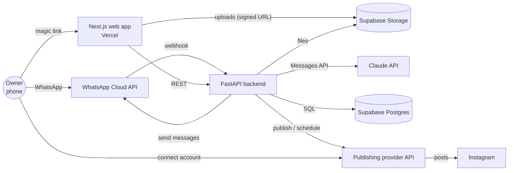
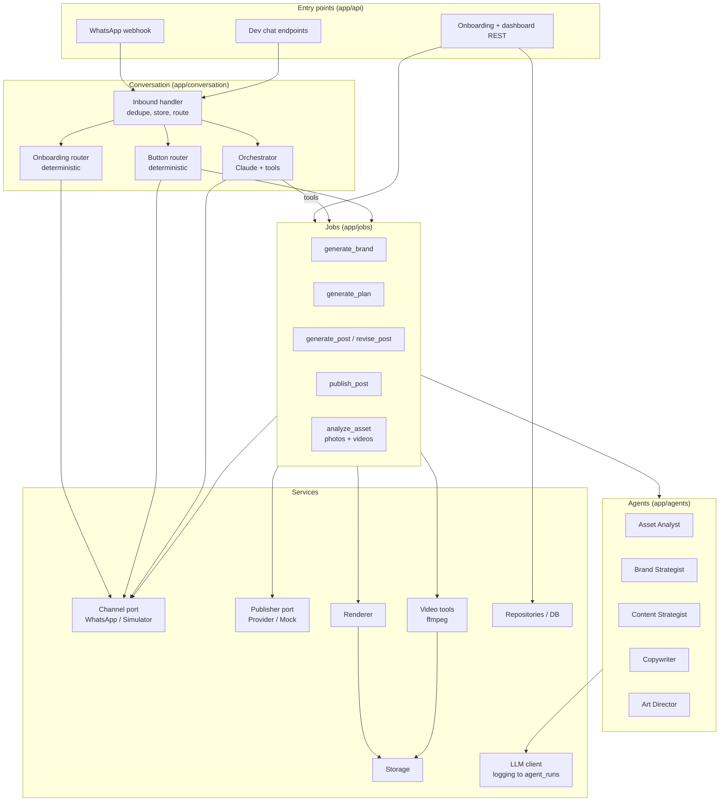
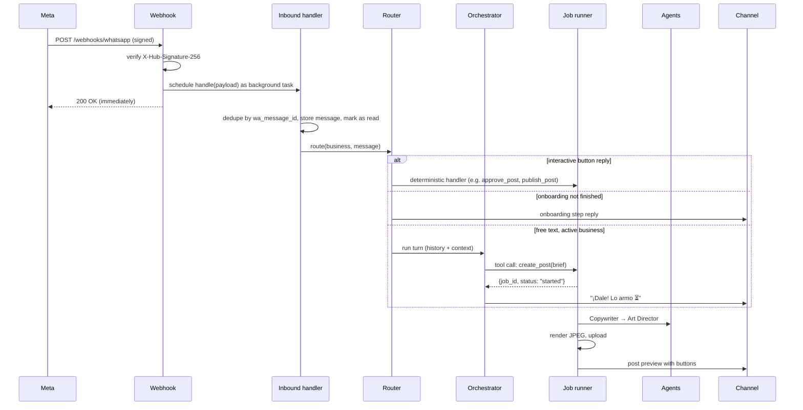
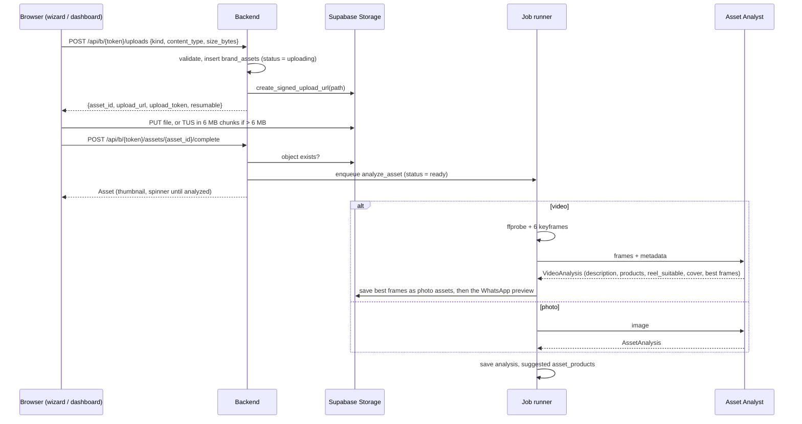

# Architecture overview

## System context



## Components

| Component | Tech | Responsibility |
|---|---|---|
| **Web app** | Next.js (App Router, TypeScript), Tailwind, shadcn/ui, on Vercel | Onboarding wizard, IG connect hand-off, **dashboard** where the Owner manages their Catalog, Brand assets (photos and videos) and Offers, **chat simulator** (`/dev/chat`) |
| **Backend API** | Python 3.13, FastAPI, uvicorn, one container (Tenki, or Railway/Render as fallback) | Webhooks, REST for the web app, orchestrator, agents, jobs, rendering, publishing |
| **Database** | Supabase Postgres | All state. Schema in [data-model.md](data-model.md) |
| **File storage** | Supabase Storage (Pro plan, 300 MB per file), two buckets: `assets` (private uploads), `renders` (public JPEGs) | Logos, photos, videos (uploaded straight from the browser), frames and WhatsApp previews cut from videos, rendered posts |
| **LLM** | Claude API (`claude-opus-5-5`) via the official `anthropic` Python SDK | Orchestrator + specialist agents. See [agents.md](agents.md) |
| **WhatsApp** | Meta WhatsApp Cloud API (direct) | Inbound/outbound messages, buttons, media |
| **Publishing** | Zernio, unified social publishing API (see [integrations.md](integrations.md#publishing-provider-zernio)) | Instagram connect + publish + schedule |
| **Renderer** | Jinja2 HTML templates → Playwright (headless Chromium) → JPEG | Deterministic branded images |
| **Video tools** | ffmpeg / ffprobe in the backend container | Video metadata, keyframes for the Asset Analyst, WhatsApp previews of Reels. Claude reads no video ([integrations.md](integrations.md#video-processing-ffmpeg)) |

## Backend internal architecture

The backend is a modular monolith. Each layer only calls the layer below it.



### Key design rules

1. **Deterministic where it matters, LLM where it helps.** Button taps, onboarding steps, approval, and publishing are plain code. The LLM handles free text, planning, writing and design choices.
2. **Agents are functions, not processes.** Each specialist is an async function: typed input (Pydantic) → one Claude call with structured output → typed output. Only the orchestrator runs a tool-use loop.
3. **Long work runs in background jobs.** The webhook returns `200` in < 1 s. The orchestrator's tools *enqueue* jobs and return immediately; jobs send their own WhatsApp messages when they finish.
4. **Ports for everything external.** `ChannelPort` (WhatsApp / Simulator), `PublisherPort` (Provider / Mock), `ImageGenPort` (None / future provider). Switching is an env var, which is also our demo fallback.
5. **Per-business serialization.** Inbound messages for the same business are processed one at a time (an in-process `asyncio.Lock` per business ID). Different businesses run concurrently.
6. **Everything is logged.** Every LLM call writes an `agent_runs` row (agent, input, output, tokens, latency, error). It's our debugger during the hackathon.

## Request lifecycle: inbound WhatsApp message



For a Reel, the Art Director picks the video and the cover frame instead of a template, nothing is rendered, and the preview's header is the video's WhatsApp preview ([integrations.md](integrations.md#sending)).

## Request lifecycle: upload from the web

The bytes never pass through the backend or Vercel: the browser writes to Storage with a one-path signed URL ([api.md](api.md#uploads), [ADR 0012](../decisions/0012-catalog-content-dashboard-reels.md)).



## Background jobs

Hackathon implementation: `asyncio.create_task` wrapped in a tiny `JobRunner` that

- writes a `jobs` row (`queued → running → succeeded | failed`) with `kind`, `payload`, `result`, `error`;
- catches exceptions, marks the job failed, and sends `job_failed` to the owner;
- limits concurrency with a semaphore (`MAX_CONCURRENT_JOBS=4`).

On process restart, `running` jobs older than 5 minutes are marked `failed` at startup (no retries in the demo).

**Production path (post-hackathon):** replace `JobRunner` with a real queue (arq on Redis, or Postgres-based like `procrastinate`) without changing job functions. That's why jobs are plain `async def job(ctx, payload)` functions.

The single-process assumption (in-memory locks, in-process jobs) is deliberate for the demo: **run exactly one backend instance**.

## Deployment

| Piece | Where | Notes |
|---|---|---|
| Web | Vercel | `NEXT_PUBLIC_API_URL` → backend URL |
| Backend | Tenki (or Railway/Render): one container, 1 instance, ≥ 1 GB RAM (Chromium), a few GB of temp disk for video processing | Dockerfile per [`.claude/rules/docker.md`](../../.claude/rules/docker.md), with Chromium installed by Playwright and `ffmpeg` |
| DB + storage | Supabase (Pro plan, global file limit 300 MB) | Schema applied with `uv run alembic upgrade head` (runs on deploy) |
| WhatsApp webhook | `https://<backend>/webhooks/whatsapp` | Configured in the Meta app dashboard |
| Secrets | Platform env vars | Full list in [../implementation/setup.md](../implementation/setup.md) |

## Security (demo-appropriate, production-ready seams)

- WhatsApp webhook: verify `X-Hub-Signature-256` with the app secret; reject unsigned requests.
- Web access: magic-link token (random 32 bytes, stored hashed, expires in 7 days) is the only credential. Every web endpoint resolves `token → business_id`; there are no business IDs in URLs. The dashboard link can edit, so anyone it's forwarded to can too: edits only archive, never hard-delete, until there are user accounts.
- Storage: `assets` bucket private (signed URLs for the web, service key for the backend); `renders` bucket public (images must be fetchable by Meta and the publishing provider). Browser uploads use signed upload URLs scoped to one path and issued only after the backend validated type and size; Reel videos reach Zernio and Meta through signed read URLs, never by making `assets` public.
- Dev endpoints (`/dev/*`) enabled only when `ENABLE_DEV_ENDPOINTS=true`, protected by `DEV_TOKEN`.
- Secrets only in env vars; `.env.example` in the repo, `.env` gitignored.

## Repository layout

```text
build101/
├── AGENTS.md                 # team workflow + MVP build rules
├── docs/                     # this documentation
├── backend/
│   ├── pyproject.toml        # uv-managed
│   ├── Dockerfile
│   ├── .env.example
│   ├── app/
│   │   ├── main.py           # FastAPI app, routers, startup
│   │   ├── config.py         # pydantic-settings
│   │   ├── api/              # webhooks_whatsapp.py, onboarding.py, dashboard.py, uploads.py, dev.py
│   │   ├── conversation/     # inbound.py, onboarding_router.py, button_router.py, state.py
│   │   ├── orchestrator/     # orchestrator.py, tools.py, prompts/system.md
│   │   ├── agents/           # asset_analyst.py, brand_strategist.py, content_strategist.py,
│   │   │                     # copywriter.py, art_director.py, schemas.py, prompts/*.md
│   │   ├── jobs/             # runner.py, brand.py, plan.py, post.py, publish.py, asset.py
│   │   ├── channels/         # base.py (ChannelPort), whatsapp.py, simulator.py
│   │   ├── publishing/       # base.py (PublisherPort), zernio.py, mock.py
│   │   ├── rendering/        # renderer.py, templates/*.html, fonts/
│   │   ├── media/            # video.py (ffprobe, keyframes, WhatsApp preview), images.py (HEIC, palette)
│   │   ├── llm/              # client.py (wrapper + agent_runs logging)
│   │   ├── storage.py
│   │   ├── copy/messages_es.py
│   │   └── db/               # models.py, session.py, repositories.py, seed.py
│   ├── migrations/           # Alembic (env.py, versions/0001_initial.py)
│   └── tests/
└── frontend/
    ├── package.json
    ├── app/
    │   ├── o/[token]/        # onboarding wizard
    │   ├── b/[token]/        # dashboard: posts, Catalog, Brand assets, Offers
    │   └── dev/chat/         # chat simulator
    ├── components/
    └── lib/                  # api.ts (typed client for the backend), upload.ts (signed / TUS uploads)
```
