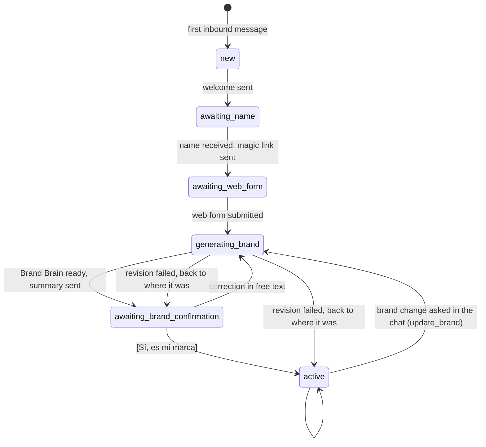
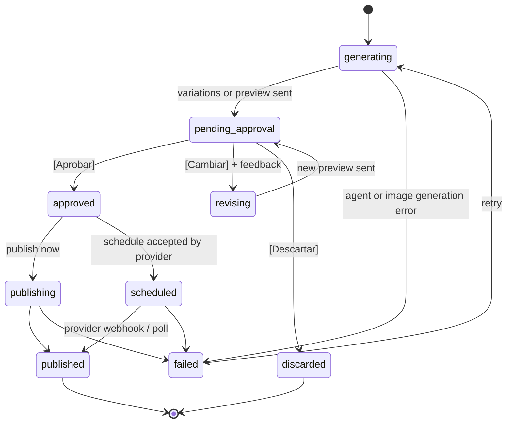

# User flows

How the product behaves, step by step. Copy for every message lives in [conversation-design.md](conversation-design.md); the code-level contracts live in [../architecture/](../architecture/).

Conventions:

- **Owner** = the business owner on WhatsApp. **Bot** = the orchestrator. **System** = backend jobs and agents.
- `[Botón]` = WhatsApp interactive reply button. Button IDs are listed in [../architecture/api.md](../architecture/api.md#button-ids).
- Anything in *italics* is a background job: the bot acknowledges right away and messages again when the job ends.
- Each flow carries its MVP priority from [mvp.md](mvp.md). The demo path ([ADR 0016](../decisions/0016-demo-scope-one-post.md)) is Flows 1 → 2 → 3, then Flow 7 → Flow 5 (image Post) → Flow 8 (publish now).
- After onboarding the conversation is open: the owner asks for things in their own words, sends photos, approves by tapping or writing. Nothing is pushed on them (no plan offered unless they ask).

## State machines

These three state machines drive everything. They are enforced in code (deterministic), never by the LLM.

### Business onboarding state (`businesses.onboarding_state`)



The states and these moves are owned by one module, `backend/app/onboarding/state.py`: nothing else writes `onboarding_state`. A failed first brand stays in `generating_brand` (the Owner gets `job_failed` with a retry button); a failed revision puts the Business back in the state it was in.

While `onboarding_state != active`, inbound messages are handled by the **onboarding router** (deterministic copy + light LLM for free-text answers). Once `active`, they go to the **orchestrator**.

### Post status (`posts.status`)



A Post has a format, `image` (an AI-generated image + caption, [ADR 0018](../decisions/0018-ai-image-generation-service.md)), `carousel` (3–10 generated slides with text from the copy + caption, F4.9, [ADR 0022](../decisions/0022-carousels-in-mvp.md)) or `reel` (the owner's video + caption + cover frame, F4.8 Could); all follow this state machine. A carousel slide redo goes `pending_approval → revising → pending_approval` like a revision.

Rule: **the only way into `approved` is the owner's explicit yes**: the `[Aprobar]` tap, or a message that clearly approves that Post ("subilo", "dale, publicalo") which the orchestrator converts into the same `approve_post` handler (Flow 8). The publish service refuses any post that is not `approved` or `scheduled`. An image Post with several variations can only be approved once the Owner has picked one; the Approval covers that variation. A carousel's Approval covers all its slides at the current revision.

### Content plan status (`content_plans.status`) — Should

`generating → pending_approval → approved | revising → pending_approval`. Approving a plan creates one `posts` row per item (status `generating`) and starts generation.

### Pending input (`businesses.conversation_state`)

A small JSON object that says what the next free-text message means. It is set by button handlers and cleared after use:

| `awaiting` | Set when | Next free-text message is treated as |
|---|---|---|
| `null` | default | normal orchestrator turn |
| `business_name` | onboarding step 1 | the business name |
| `brand_correction` | owner taps [Corregir algo] on the Brand Brain summary | a correction to the Brand Brain |
| `plan_feedback` | owner taps [Cambiar] on a plan | feedback for the plan (`plan_id`) |
| `post_feedback` | owner taps [Cambiar] on a post | feedback for the post (`post_id`); on a carousel, which slides to redo and how, turned into `redo_slides` by the orchestrator |
| `schedule_time` | owner taps [Programar] | a date/time in natural language (`post_id`) |
| `variation_choice` | `generate_post` sent several variations of a Post | the Owner's pick ("la 2"), passed to `pick_variation` (`post_id`); how the Owner picks is not decided ([open questions](../open-questions.md#post-images-generated-by-ai-adr-0018)) |
| `post_brief` | the orchestrator asked its one question before creating a Post (Flow 7) | the answer, added to the brief of that request (photos and request kept in the context) |
| `offer_details` | the orchestrator asked for a missing Offer condition (Flow 12, Could) | the price, discount or validity for the draft Offer (`offer_id`) |

If the owner writes something unrelated while `awaiting` is set (e.g. a new request), the orchestrator gets the message **plus** the pending context and decides; it can call `cancel_pending` and handle the new request.

---

## Flow 1 — First contact (Must)

Trigger: a phone number with no `businesses` row sends any message (in the demo: "Hola").

Before this flow, and before any other: a number not on the pilot list (#186, [setup.md § Pilot numbers](../implementation/setup.md#pilot-numbers)) gets the `waitlist` reply, at most once a day, and nothing else. No `businesses` row, no link, no AI call; an existing Business whose number left the list keeps its data and gets the same reply.

1. System creates `businesses` row (`onboarding_state = new`, `owner_phone`), stores the message.
2. Bot sends the welcome (who it is, what it does, that nothing is published without approval) and asks for the business name. State → `awaiting_name`.
3. Owner replies with the name ("Muebles Ramírez").
4. Bot confirms, creates a magic link (`/o/{token}`, valid 7 days, reusable until the form is submitted) and sends it with a short explanation: "5 minutos, desde el celu". State → `awaiting_web_form`.
5. If the owner writes again before finishing the form, the bot answers briefly and re-sends the link. It doesn't try to run the orchestrator yet.

## Flow 2 — Web onboarding form (Must)

Opened from the magic link on the owner's phone. Short, mobile-first wizard of 6 steps plus a closing screen; progress saved after each step (owner can close and come back). Instagram comes second so it can answer for the Owner ([ADR 0032](../decisions/0032-instagram-first-onboarding.md)). Details and wireframes in [../design/web-app.md](../design/web-app.md) and the [mockups](../design/mockups/README.md) (the mockups show the earlier order).

| Step | Fields | Notes |
|---|---|---|
| 1. Tu negocio | Name (prefilled), category (chips), one-line description, city/zone (optional) | Category list: Muebles y deco, Gastronomía, Indumentaria, Belleza, Servicios, Otro (free text). No Instagram handle: the connect in step 2 fills it in. Examples in later steps follow the category |
| 2. Conectá Instagram | Button → Instagram's consent screen (our Meta app, Instagram Login, read only) → the backend callback → returns to the wizard with ✅ @handle | Reads the account for the Brand Brain ([ADR 0028](../decisions/0028-read-instagram-with-our-meta-app.md)); publishing still goes to the demo account ([ADR 0024](../decisions/0024-mvp-single-demo-instagram-account.md)). Skippable ("No tengo, o lo hago después"). Copy: nothing is published without approval on WhatsApp, they log in on Instagram's page and we never see their password, and we bring their photos and captions to learn their style. A refused consent comes back with an error and the button to retry. The import runs while the owner goes on |
| 3. Productos | Up to 5 products/services (≥ 1): name, short description (optional), price (optional), and up to 5 photos of that product (optional) | "¿Qué es lo que más vendés? Hasta 5, los que más te importa vender." A product's photos are linked to it (`asset_products`, `source = 'owner'`), so the agents know which photos show which product without guessing. More can be added later from the chat or the dashboard (Flows 11–12, Could) |
| 4. Tus fotos | At least 3 photos in all, counting the products' photos from step 3 and the ones imported from Instagram; up to 15 uploads; here the rest (workshop, team, finished work); no videos | Show thumbnails and upload progress, a "7 fotos" counter and "Mínimo 3" (plus "2 de tus productos" when step 3 has photos, which aren't repeated in the grid). Imported photos show under "De @handle", with ✕ to drop one; the step polls for up to 90 s while the import runs. "Uso tus fotos reales, sin cambiar tu producto" |
| 5. Tu marca | Live post preview; logo upload (optional); brand colors (auto-detected from logo, editable as swatches); "¿Cómo te describirían tus clientes?" (1 to 3 word chips, suggested by category, or their own) | Colors are extracted server-side from the logo right after upload. "Todavía no tengo logo ni colores" skips logo and colors: the Brand Brain starts with neutral default colors, and Flow 13 (Could) builds them in the chat |
| 6. Preferencias | Questionnaire (see below) | All taps except the two optional texts. With Instagram connected, the tone questions are hidden behind "Prefiero elegirlo yo" and sent as null, so the Brand Strategist learns the tone from the captions |
| 6b. Trajimos tu feed | Grid of the photos and videos imported from the connected Instagram feed; the owner unticks what not to use | **Not built**: the import runs automatically after step 2 and its photos show in step 4's grid, where the owner can drop them ([ADR 0032](../decisions/0032-instagram-first-onboarding.md)) |
| ¡Listo! | Summary (Products, colors, photos with how many came from Instagram, Instagram handle) + "Volver a WhatsApp" (wa.me deep link) | Submitting triggers Flow 3 |

Questionnaire (step 6):

| Question | Type | Options |
|---|---|---|
| ¿Qué querés lograr con tus redes? | single | Más consultas y ventas · Que me conozca más gente · Lanzar algo nuevo · Que vuelvan mis clientes |
| ¿A quién le vendés? | multi | Four audiences by category (furniture: Familias · Parejas jóvenes · Empresas y oficinas · Arquitectos y decoradores) · Otro (texto) |
| El tono | 2 sliders | Formal ↔ Cercano · Serio ↔ Divertido. Hidden and sent as null when Instagram is connected, unless the owner taps "Prefiero elegirlo yo" |
| ¿Usamos emojis? | single | Sí, bastantes · Pocos · Ninguno. Shown with the tone |
| ¿Hay algo que NO quieras que diga o muestre? | short text (optional) | e.g. "no hablar de precios" |
| ¿Tenés alguna promo o novedad ahora? | short text (optional) | Passed to the agents with the onboarding answers and shown in the brand summary; becomes a draft Offer once F8.6 (Could) is built |

Posts per week is no longer asked: nothing schedules yet (T30), and the Brand Brain defaults to 3.

On submit: `POST /api/o/{token}/complete` → state `generating_brand` → Flow 3 starts in the background. A number not on the pilot list can't save a step or submit (`403 not_in_pilot` from its first save): nothing is uploaded, analysed or imported, and no brand generation starts.

## Flow 3 — Brand Brain generation and confirmation (Must)

1. *System runs the Asset Analyst on each uploaded photo that doesn't have an analysis yet (parallel, max 5 concurrent).*
2. *System runs the Brand Strategist with all onboarding data + asset descriptions → Brand Brain v1 (saved, versioned).*
3. Bot sends `brand_generating` right after submit, then `brand_summary`: the Brand Strategist's short summary (tone in 3 words, audience, 3 content pillars, colors as text, the current promo if the owner gave one) + buttons `[Sí, es mi marca]` `[Corregir algo]`. State → `awaiting_brand_confirmation`.
4. `[Sí, es mi marca]` → state `active` → bot sends `ready_open_chat` ("¡Listo, ya conozco tu marca! ¿En qué te puedo ayudar hoy?"), no buttons. The chat is open: the next message is a normal orchestrator turn (F1.10).
5. `[Corregir algo]` → `awaiting = brand_correction` → owner writes the correction → *Brand Strategist runs in "revise" mode (Brand Brain v2)* → back to step 3 (F2.6, Could; without it the bot notes the correction and keeps the summary).

Target time from form submit to summary: **< 60 s**.

## Flow 4 — Weekly plan (Should)

Trigger: only on request, free text like "armame el plan de la semana" (orchestrator → `plan_week`). The bot never offers the plan unprompted.

1. Bot sends `plan_generating`.
2. *Content Strategist generates N items (N = posts per week from the Brand Brain, 3 by default) from the Brand Brain, the Catalog, the active Offers and the Brand assets. Each item: date, pillar, format, idea, angle, Product and Offer IDs (optional), suggested asset IDs. Reels (`format = reel`) only once F4.8 is built: at most one per plan, and only when a reel-suitable video exists.*
3. Bot sends the plan as one message:

   ```text
   📅 Plan semana del 20/10
   1. Mar 21 — Producto estrella: la mesa de roble Nórdica, foco en la madera maciza
   2. Jue 23 — Detrás de escena: así se hace una silla en el taller
   3. Sáb 25 — Promo: 10% off en racks de TV este fin de semana
   ```

   with buttons `[Aprobar plan]` `[Cambiar algo]`.
4. `[Aprobar plan]` → plan `approved`, one `posts` row per item → bot sends `plan_approved` → Flow 5 for each post (sequentially, so previews arrive in order).
5. `[Cambiar algo]` → `awaiting = plan_feedback` → owner: "cambiá la 2 por algo de la promo de sillas" → *Content Strategist revises* → step 3 (F3.3, Could).

## Flow 5 — Post generation and approval (Must)

Trigger: an ad-hoc request (Flow 7, the demo path), plan approval (one per item, Should), or revision (Flow 6, Should).

### Image Post

1. *Copywriter* produces: caption (150–900 chars), hashtags (5–10), CTA. Nothing is written on the image.
2. *Art Director* picks the reference photos (the ones the Owner sent with the request first) and writes the image prompt from the Brand Brain, the brief and trend notes. Output is an **image brief** (JSON). The prompt forbids any text, price, offer or logo change in the image ([agents.md](../architecture/agents.md#art-director)).
3. *Image generator* (no LLM of ours) sends the reference photos and the prompt to the image service ([ADR 0019](../decisions/0019-image-provider-gemini.md)) once per variation, in parallel, resizes each result to 1080×1350 JPEG and uploads it to storage.
4. If there are several variations, the bot sends them as numbered images and waits for the Owner's pick (`awaiting = variation_choice`; draft copy `post_variations` in [conversation-design.md](conversation-design.md)). The number of variations and how the Owner picks are not decided ([open questions](../open-questions.md#post-images-generated-by-ai-adr-0018)).
5. With the picked variation (or the only one), the bot sends **one interactive message**: image header + body (label line + full caption + hashtags) + buttons:

   ```text
   [image header]
   📝 Post para el martes 21 — "Mesa Nórdica"

   <full caption + hashtags>

   [Aprobar] [Cambiar] [Descartar]
   ```

   WhatsApp limits the interactive body to 1,024 chars. If the body would exceed it, send the full caption first as a plain text message and use a short body ("📝 Post para el martes 21 — ¿lo aprobás?") in the interactive message. See [../architecture/integrations.md](../architecture/integrations.md#whatsapp).
6. Post status → `pending_approval` from the first message the Owner sees (variations or preview).

Target time per post: **< 45 s** from start to preview was set for rendered templates. Image generation latency is not measured yet (no official Gemini figure; OpenAI documents up to 2 minutes for complex prompts), so the target is re-set after the first real calls ([research](../research/image-generation-providers.md#open-points-test-hands-on-before-committing)).

### Carousel (Must, F4.9)

[ADR 0022](../decisions/0022-carousels-in-mvp.md). Trigger: the Owner asks for a carousel ("armame un carrusel con estas fotos", "hacé uno de 6 slides") → `create_post(format = "carousel", slide_count)`.

1. *Copywriter* (carousel mode) writes the caption, hashtags and the text of each slide: a cover, content slides and usually a closing call to action; 3–5 slides, or the Owner's number up to 10.
2. *Art Director* (carousel mode) picks the reference photos and writes one shared style plus one scene per slide. It writes no text.
3. *Carousel generator* generates text-free scenes: the cover first, then the other slides in parallel with the cover as a reference for light and palette, or one wide scene sliced into the slides for a `panorama`. The *Slide renderer* then sets each slide's text, numbering, brand mark and layout from the chosen template family ([ADR 0029](../decisions/0029-designed-slides-ai-scene-code-layout.md)).
4. The bot sends the slides in order as numbered images ("1/5", "2/5"…), then `carousel_preview`:

   ```text
   🖼️ Carrusel para {when_label} — "{title}" ({count} slides)

   <full caption + hashtags>

   [Aprobar] [Cambiar] [Descartar]
   ```

5. `[Cambiar]` → `carousel_redo_ask` ("¿Qué slide cambio y cómo? Decime el número."). The Owner can also write it directly while the preview is pending ("cambiá la 3, más luminosa"). `redo_slides` regenerates only those slides, sends them again numbered, then the preview. There are no Variations: one carousel per request.
6. Approval and publishing as for image Posts (Flow 8); the publisher sends the slides in order as one Instagram carousel.

### Reel (Could, F4.8)

1. *Copywriter* produces the caption (shorter hook first), hashtags and CTA; no on-image headline.
2. *Art Director* chooses a reel-suitable video asset and its cover frame (`cover_offset_ms`). No image generation: the video is published as the owner shot it; the cover is a frame extracted with ffmpeg.
3. Bot sends the preview with the same `[Aprobar] [Cambiar] [Descartar]` buttons and body as the image Post: the video itself when it fits WhatsApp's media size limit, otherwise the cover image plus a link to the Reel preview in the dashboard.
4. Post status → `pending_approval`. Approval works exactly as for image Posts ([ADR 0007](../decisions/0007-approve-every-post.md)).

## Flow 6 — Change request (revision) (Should)

1. Owner taps `[Cambiar]` → bot sends `post_change_prompt`. `awaiting = post_feedback`.
2. Owner writes feedback.
3. System classifies the feedback (inside the revision job, one LLM call). Image Posts: `copy` / `image` / `both`. Reels: `copy` / `cover` / `video`.
   - `copy` → Copywriter revises with feedback + previous version.
   - `image` → Art Director revises the image brief (references and prompt); the variations are generated again and the Owner picks again.
   - `both` → both, copy first.
   - `cover` → Art Director picks another cover frame of the same video.
   - `video` → Art Director swaps to another reel-suitable video ("usá el video de la mesa"). Requests to edit the video itself (cuts, music, text on top) get a short "todavía no edito videos" reply.
4. `post_revisions` row saved (keeps history); `posts.revision += 1`; Flow 5 from step 4 again (new variations only when the image changed, otherwise straight to the preview).
5. After 3 revisions, bot also sends `revision_photo_hint`.

Approving in free text is covered in Flow 8.

## Flow 7 — Post on request (Must, the demo's core)

Trigger: the owner asks for a post in their own words, with or without photos. Examples from the [mockups](../design/mockups/README.md):

- Two photos + "me llegó esta mesa ratona nueva 😍 armame algo para subir"
- Two photos + "Terminamos hoy la biblioteca para un cliente de Carrasco 🙌 ¿Me armás algo para subir el viernes?"
- Text only: "hacé un post para la promo del finde, 15% en sillas"

1. Photos sent with the request are stored as Brand assets first (Flow 9) and become the preferred reference photos for this Post's image. Whether they replace or complement the Business's photo library is not decided ([open questions](../open-questions.md#post-images-generated-by-ai-adr-0018)).
2. **At most one question.** If one short answer would change the Post (the angle, a price, what to highlight, whether a client can be named), the orchestrator asks it in one line and waits with `awaiting = post_brief`: "¡Qué linda! 😍 Ya guardé las fotos. ¿La mostramos como novedad o tiene algún precio de lanzamiento?". If the request is already clear, it asks nothing. It never asks two questions in a row before creating; anything else it assumes and the owner can change later.
3. Orchestrator calls `create_post(brief=..., asset_ids=[photos sent], when=null)`. The bot acknowledges in a generated line that names its choice ("Dale, lo armo con la foto del detalle de la veta ⏳"), falling back to `post_generating`.
4. Flow 5 with the brief instead of a plan item. The Copywriter receives the brief verbatim (including the owner's answer) plus the Brand Brain. Prices and promos only appear if the owner gave them.
5. Approval and publishing: Flow 8, by button or by writing.

A carousel request ("armame un carrusel con estas fotos") follows the same steps with `create_post(format = "carousel", slide_count)` and Flow 5's carousel path ([ADR 0022](../decisions/0022-carousels-in-mvp.md)).

Could: a promo with its conditions ("15% en sillas este finde") is saved as an Offer first (Flow 12). "Hacé un reel con el video del taller" → `create_post(format=reel, ...)` (F4.8).

## Flow 8 — Publish or schedule (Must: publish now; Should: schedule)

**By writing (F5.6).** While a Post is `pending_approval`, a message that clearly approves it is the same as `[Aprobar]` plus the choice below:

| Owner writes | Orchestrator does | Bot replies (generated, matching the owner's style) |
|---|---|---|
| "subilo", "subila", "dale, publicalo" | `approve_post` → `publish_post(now)` | "arriba ✅" … then `published` with the permalink |
| "me encanta!! subilo mañana a la tarde" | `approve_post` → `schedule_post(when)` (Should) | "¡Genial! Sale mañana jueves a las 18:00 ✅" |
| "me gusta" (no action) | asks once: publish now or schedule? (`publish_when_adhoc`) | — |

If several Posts are `pending_approval`, the orchestrator asks which one, showing the list. Vague times map to fixed defaults in the business timezone (mañana = 10:00, tarde = 18:00, noche = 21:00). Anything that isn't a clear yes for a specific Post is never treated as approval ([ADR 0007](../decisions/0007-approve-every-post.md)).

**By button**, after `[Aprobar]`:

1. If the post has a planned date in the future → bot sends `publish_when`.
   If not (ad-hoc) → bot sends `publish_when_adhoc`.
2. `[Publicar ahora]` → status `publishing` → Publisher service → on success `published`, store `external_post_id` + `permalink` → bot sends `published` with the permalink. A Reel goes out as a single-video Reel through Zernio; Instagram processes the video for up to a few minutes, so the Post stays `publishing` until the provider reports it.
3. `[Programar]` → if planned date exists, use it; otherwise `awaiting = schedule_time` → owner: "el jueves a las 8 de la noche" → orchestrator parses to ISO datetime in the business timezone (`America/Montevideo`) → confirm → provider schedules → status `scheduled` → bot sends `scheduled`. When the provider later reports the publish, the bot sends `published` (only deliverable inside the 24-hour window, see [integrations.md](../architecture/integrations.md#receiving)).
4. No Instagram connected → bot sends `need_ig`. The post stays `approved`. In the MVP Instagram is always "connected": the demo account comes from env ([ADR 0024](../decisions/0024-mvp-single-demo-instagram-account.md)), so this path only fires with `PUBLISHER=zernio` and no `ZERNIO_ACCOUNT_ID`, or for an Owner other than `ZERNIO_OWNER_PHONE` while every Post goes to that shared account (the interim guard in [ADR 0024](../decisions/0024-mvp-single-demo-instagram-account.md#interim-publish-guard-2026-10-20)). After the MVP it is the path for a Business that has not connected.
5. Failure → status `failed` → bot sends `publish_failed`.

## Flow 9 — Owner sends a photo in the chat (Must; videos Could)

1. System downloads the media, stores it as a `brand_assets` row (`kind = photo`, `source = whatsapp`). WhatsApp delivers an album as one message per photo; photos that arrive within a few seconds of each other are handled together.
2. *Asset Analyst analyzes it.*
3. If the photos come with a request ("armame algo para subir"), it's Flow 7.
4. If a post is `pending_approval` and `awaiting = post_feedback`, or the caption says "usá esta para el post", the orchestrator uses it for that post (Art Director revision with `force_asset_id`, Should).
5. Otherwise bot sends `photo_saved` with `[Sí, armalo]` `[No, guardala]`; "No" → a one-line confirmation ("Listo, queda guardada 👌").
6. Videos (Could): stored as `kind = video` and read from keyframes; the confirmation says whether it can be used as a Reel.

## Flow 10 — Everything else

| Situation | Behavior |
|---|---|
| "¿Qué podés hacer?" / "ayuda" | Orchestrator explains the 4 things it does in ≤ 5 short lines |
| "¿Qué tengo programado?" / "¿cuándo sale lo de la mesa ratona?" | `list_posts(status in [scheduled, approved, pending_approval])` → short answer ("Hoy jueves a las 18:00 ✅ Si querés cambiarle algo antes, decime.") |
| "No sé qué subir, ¿se te ocurre algo?" | Flow 14 (Should) |
| "¿Dónde veo todo?" / "link" (once `active`) | Bot sends a fresh dashboard link (Flow 11; read-only dashboard is Should) |
| "Gracias" / small talk | One short, warm line ("¡De nada! Acá estoy cuando me necesites 🙌"); no tool call |
| Brand change in chat ("ahora tenemos envío gratis a todo el país") | `update_brand_brain(change)` → Brand Brain new version → orchestrator confirms in one short line |
| Voice note | Transcribed and handled like a text message ([ADR 0021](../decisions/0021-voice-notes-kapso-transcript-gemini-fallback.md)); `audio_unclear` if no speech comes through, `audio_too_long` over the size cap |
| Sticker, location, document | `unsupported_media` (Could: a price-list PDF or photo becomes Products to confirm, F8.8) |
| Out-of-scope request ("¿me hacés una factura?") | Explain what it does; no tool call |
| Repeated webhook delivery | Ignored (idempotency on `wa_message_id`) |
| Message while a job is running | Answered normally; jobs post their results when done |
| Agent or image generation error | Post → `failed`; bot apologizes in one line, offers `[Reintentar]`; full error in `agent_runs` |

## Flow 11 — Dashboard: Catalog and content (read-only view Should; editing Could)

Trigger: the owner writes "¿dónde veo todo?" or "link", or the bot suggests it ("Si tenés más fotos o videos, subilos acá 👇"). Wireframes in [../design/web-app.md](../design/web-app.md).

1. System creates a `dashboard` magic link (`/b/{token}`, valid 7 days, editable) and the bot sends it. An expired link shows a friendly screen asking the owner to write "link".
2. **Catalog**: the owner adds, edits or archives Products (name, description, optional price and category).
3. **Fotos y videos**: the owner multi-selects from the camera roll. Each file is uploaded from the browser straight to storage with a signed upload URL, with a progress bar per file; on completion *the Asset Analyst analyzes it* and suggests which Products it shows. The owner can correct the Product links (F8.5).
4. **Promos**: the owner creates or edits Offers: type (pack or promo), title, Products included, conditions, price or discount, optional start and end dates (F8.6).
5. The Brand Brain and the Posts with their status are read-only here; Brand Brain changes still go through the chat.
6. Archiving a Product, Brand asset or Offer hides it from the agents and the dashboard. Published and scheduled Posts don't change; draft Posts that use it are flagged for review. Nothing is hard-deleted.
7. New material is used from the next plan or ad-hoc Post on; the bot doesn't message the owner for each upload.

## Flow 12 — Product or Offer from the chat (Could)

Trigger: free text like "agregá la silla Oslo a $4500" or "este finde hay 15% en sillas".

1. Orchestrator extracts the Product or Offer (`save_product` / `save_offer` with `confirmed = false`, see [../architecture/agents.md](../architecture/agents.md)) and reads it back in one short message ending in "¿Lo guardo así?". Prices and conditions come only from what the owner wrote; nothing is invented.
2. If an Offer is missing a condition that matters (the discount, the price of a pack, until when), the bot asks **one** question → `awaiting = offer_details`.
3. Owner says yes → the tool is called again with `confirmed = true`: Product saved to the Catalog, or Offer set to active → one-line confirmation. A correction in free text → step 1.

## Flow 13 — Brand without a logo or colors (Could)

Trigger: the owner ticked "Todavía no tengo logo ni colores" in the wizard (Flow 2, step 5). Runs right after `[Sí, es mi marca]`, instead of `ready_open_chat`.

1. Bot: "Vi que todavía no tenés logo ni colores definidos. ¡No pasa nada, lo armamos acá! ¿Me mandás una foto de algo que te represente? Tu local, un producto, o una marca que te guste."
2. Owner sends a photo ("esto es el taller, me gusta así natural").
3. *Palette extraction + Brand Strategist* propose 3 named palettes ("Bosque", "Nogal", "Carbón"), sent as one image with the 3 swatches numbered.
4. Owner picks and adjusts in free text ("la 2, pero el marrón un toque más claro") → new Brand Brain version with those colors → bot shows the result ("Así 👇").
5. Bot offers a simple text logo with the business name, or to leave it for later. Then `ready_open_chat`.

## Flow 14 — Ideas on request (Should)

Trigger: "no sé qué subir esta semana, se te ocurre algo?"

1. Orchestrator asks the Content Strategist for 3 short ideas from the Brand Brain, recent Posts and the available photos, and sends them as a numbered list ending in "¿Alguna te gusta?".
2. The owner picks one or more, with or without conditions ("la del taller, pero sin mostrar caras"; "y el tip también").
3. Each pick becomes a Flow 7 request with the idea + the owner's conditions as the brief; constraints like "sin caras" also go to the Brand Brain if they sound permanent (confirmed in one line: "Anotado, nada de caras 👍").
