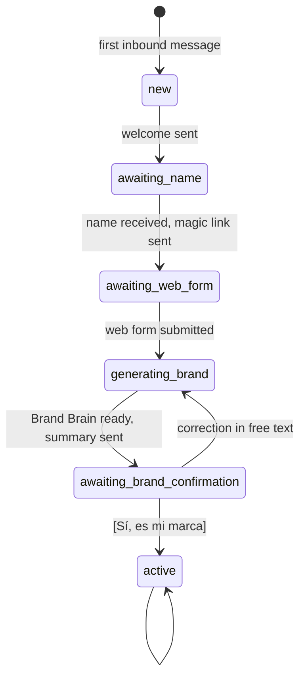
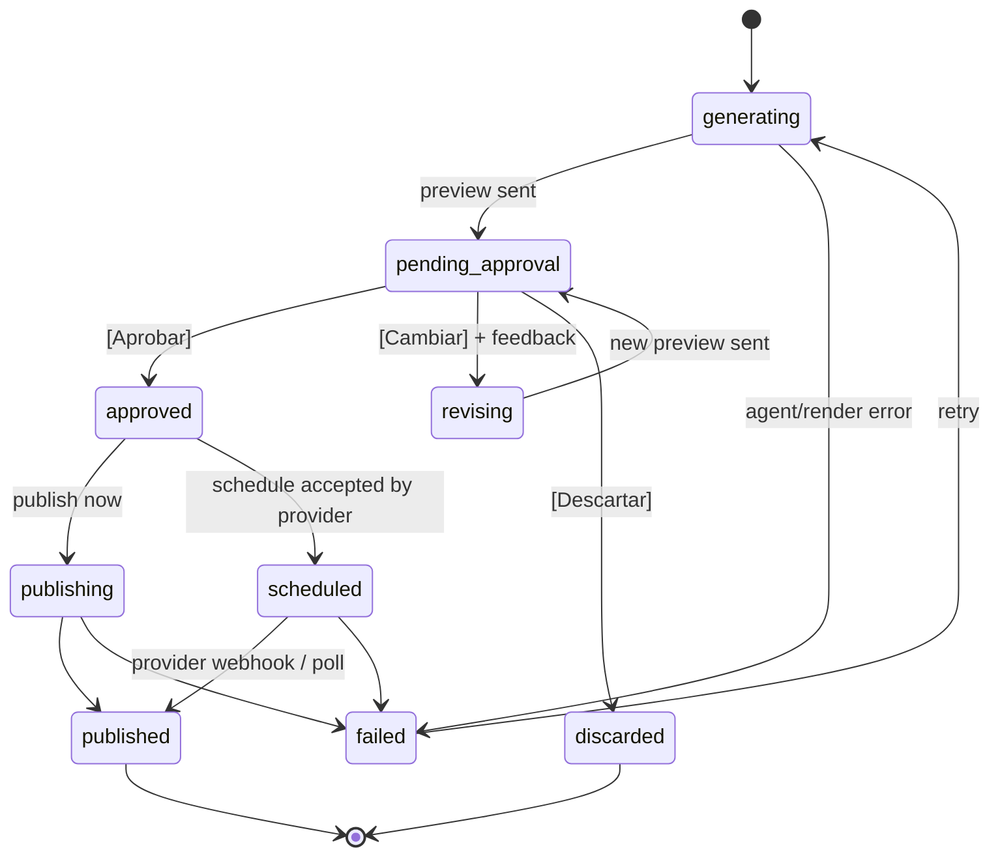

# User flows

How the product behaves, step by step. Copy for every message lives in [conversation-design.md](conversation-design.md); the code-level contracts live in [../architecture/](../architecture/).

Conventions:

- **Owner** = the business owner on WhatsApp. **Bot** = the orchestrator. **System** = backend jobs and agents.
- `[Botón]` = WhatsApp interactive reply button. Button IDs are listed in [../architecture/api.md](../architecture/api.md#button-ids).
- Anything in *italics* is a background job: the bot acknowledges right away and messages again when the job ends.

## State machines

These three state machines drive everything. They are enforced in code (deterministic), never by the LLM.

### Business onboarding state (`businesses.onboarding_state`)



While `onboarding_state != active`, inbound messages are handled by the **onboarding router** (deterministic copy + light LLM for free-text answers). Once `active`, they go to the **orchestrator**.

### Post status (`posts.status`)



A Post has a format, `image` (branded image + caption) or `reel` (the owner's video + caption + cover frame); both follow this state machine.

Rule: **the only way into `approved` is the owner's button tap** (or an explicit "sí, aprobalo" that the orchestrator converts into the same `approve_post` handler, see Flow 6). The publish service refuses any post that is not `approved` or `scheduled`.

### Content plan status (`content_plans.status`)

`generating → pending_approval → approved | revising → pending_approval`. Approving a plan creates one `posts` row per item (status `generating`) and starts generation.

### Pending input (`businesses.conversation_state`)

A small JSON object that says what the next free-text message means. It is set by button handlers and cleared after use:

| `awaiting` | Set when | Next free-text message is treated as |
|---|---|---|
| `null` | default | normal orchestrator turn |
| `business_name` | onboarding step 1 | the business name |
| `brand_correction` | owner taps [Corregir algo] on the Brand Brain summary | a correction to the Brand Brain |
| `plan_feedback` | owner taps [Cambiar] on a plan | feedback for the plan (`plan_id`) |
| `post_feedback` | owner taps [Cambiar] on a post | feedback for the post (`post_id`) |
| `schedule_time` | owner taps [Programar] | a date/time in natural language (`post_id`) |
| `offer_details` | the orchestrator asked for a missing Offer condition (Flow 12) | the price, discount or validity for the draft Offer (`offer_id`) |

If the owner writes something unrelated while `awaiting` is set (e.g. a new request), the orchestrator gets the message **plus** the pending context and decides; it can call `cancel_pending` and handle the new request.

---

## Flow 1 — First contact

Trigger: a phone number with no `businesses` row sends any message (in the demo: "Hola").

1. System creates `businesses` row (`onboarding_state = new`, `owner_phone`), stores the message.
2. Bot sends the welcome (who it is, what it does, that nothing is published without approval) and asks for the business name. State → `awaiting_name`.
3. Owner replies with the name ("Muebles Ramírez").
4. Bot confirms, creates a magic link (`/o/{token}`, valid 7 days, reusable until the form is submitted) and sends it with a short explanation: "5 minutos, desde el celu". State → `awaiting_web_form`.
5. If the owner writes again before finishing the form, the bot answers briefly and re-sends the link. It doesn't try to run the orchestrator yet.

## Flow 2 — Web onboarding form

Opened from the magic link on the owner's phone. Mobile-first wizard, progress saved after each step (owner can close and come back). Details and wireframes in [../design/web-app.md](../design/web-app.md).

| Step | Fields | Notes |
|---|---|---|
| 1. Tu negocio | Name (prefilled), category (select), one-line description, longer description (optional), city/zone, website or IG handle (optional) | Category list: Muebles y deco, Gastronomía, Indumentaria, Belleza, Servicios, Otro |
| 2. Productos | Products/services, as many as the owner wants (≥ 1): name, short description, price (optional) | "¿Qué es lo que más vendés?"; each one becomes a Product in the Catalog. More can be added later from the dashboard (Flow 11) or the chat (Flow 12) |
| 3. Tu marca | Logo upload; brand colors (auto-detected from logo, editable as swatches); "¿Cómo hablarían de tu marca tus clientes?" (3 words) | Colors are extracted server-side from the logo right after upload |
| 4. Fotos y videos | Upload photos and videos (products, workshop, team), no upper count | The more, the better; show thumbnails and upload progress; at least 3 photos required, videos optional. Files go straight to storage (limits in [mvp.md](mvp.md#f8--catalog--content)) |
| 5. Preferencias | Questionnaire (see below) | All single taps, no long text |
| 6. Conectá Instagram | Button → provider's hosted connect flow → returns to the wizard with ✅ | Skippable ("Lo hago después"); publishing is then mocked until connected |
| 7. ¡Listo! | Summary + "Volver a WhatsApp" (wa.me deep link) | Submitting triggers Flow 3 |

Questionnaire (step 5):

| Question | Type | Options |
|---|---|---|
| ¿Qué querés lograr con tus redes? | single | Más consultas y ventas · Que me conozca más gente · Lanzar algo nuevo · Fidelizar a mis clientes |
| ¿A quién le vendés? | multi | Familias · Parejas jóvenes · Empresas/oficinas · Arquitectos/decoradores · Otro (texto) |
| ¿Cómo querés sonar? | 2 sliders | Formal ↔ Cercano · Serio ↔ Divertido |
| ¿Cuántas publicaciones por semana? | single | 2 · 3 · 5 |
| ¿Usamos emojis? | single | Sí, bastantes · Pocos · Ninguno |
| ¿Hay algo que NO quieras que digamos o mostremos? | short text (optional) | e.g. "no hablar de precios" |
| ¿Tenés alguna promo o novedad ahora? | short text (optional) | Creates a draft Offer, confirmed together with the brand summary (Flow 3) |

On submit: `POST /api/o/{token}/complete` → state `generating_brand` → Flow 3 starts in the background.

## Flow 3 — Brand Brain generation and confirmation

1. *System runs the Asset Analyst on each uploaded photo and video that doesn't have an analysis yet (parallel, max 5 concurrent). Videos are read from keyframes extracted with ffmpeg; the analysis says whether the video is reel-suitable and suggests which Products it shows.*
2. *System runs the Brand Strategist with all onboarding data + asset descriptions → Brand Brain v1 (saved, versioned).*
3. Bot sends `brand_summary`: the Brand Strategist's short summary (tone in 3 words, audience, 3 content pillars, colors as text) + the draft Offer if the owner gave one ("Promo: 10% en racks de TV este finde") + buttons `[Sí, es mi marca]` `[Corregir algo]`. State → `awaiting_brand_confirmation`.
4. `[Sí, es mi marca]` → state `active`, the draft Offer becomes active → bot sends `ready_first_plan`.
5. `[Corregir algo]` → `awaiting = brand_correction` → owner writes the correction → *Brand Strategist runs in "revise" mode (Brand Brain v2)* → back to step 3.

Target time from form submit to summary: **< 60 s**.

## Flow 4 — Weekly plan

Trigger: `[Dale]` after onboarding, or free text like "armame el plan de la semana" (orchestrator → `plan_week`).

1. Bot sends `plan_generating`.
2. *Content Strategist generates N items (N = posts per week from onboarding; demo default 3) from the Brand Brain, the Catalog, the active Offers and the Brand assets. Each item: date, pillar, format (`image` or `reel`), idea, angle, Product and Offer IDs (optional), suggested asset IDs, suggested template (image only). At most one Reel per plan, and only when a reel-suitable video exists, unless the owner asks for more.*
3. Bot sends the plan as one message:

   ```text
   📅 Plan semana del 20/10
   1. Mar 21 — Producto estrella: la mesa de roble Nórdica, foco en la madera maciza
   2. Jue 23 — 🎬 Reel: así se hace una silla en el taller
   3. Sáb 25 — Promo: 10% off en racks de TV este fin de semana
   ```

   with buttons `[Aprobar plan]` `[Cambiar algo]`.
4. `[Aprobar plan]` → plan `approved`, one `posts` row per item → bot sends `plan_approved` → Flow 5 for each post (sequentially, so previews arrive in order).
5. `[Cambiar algo]` → `awaiting = plan_feedback` → owner: "cambiá la 2 por algo de la promo de sillas" → *Content Strategist revises* → step 3.

## Flow 5 — Post generation and approval

Trigger: plan approval (one per item), ad-hoc request (Flow 7), or revision (Flow 6).

### Image Post

1. *Copywriter* produces: caption (150–900 chars), hashtags (5–10), CTA, `headline` (≤ 40 chars for the image), optional `subheadline` (≤ 60 chars).
2. *Art Director* chooses: template ID, photo asset ID (from the business's photos), text for each template slot, color roles (from the Brand Brain palette). Output is a **render spec** (JSON).
3. *Renderer* (deterministic, no LLM) renders HTML template → JPEG 1080×1350 → uploads to storage → public URL.
4. Bot sends **one interactive message**: image header + body (label line + full caption + hashtags) + buttons:

   ```text
   [image header]
   📝 Post para el martes 21 — "Mesa Nórdica"

   <full caption + hashtags>

   [Aprobar] [Cambiar] [Descartar]
   ```

   WhatsApp limits the interactive body to 1,024 chars. If the body would exceed it, send the full caption first as a plain text message and use a short body ("📝 Post para el martes 21 — ¿lo aprobás?") in the interactive message. See [../architecture/integrations.md](../architecture/integrations.md#whatsapp-cloud-api).
5. Post status → `pending_approval`.

Target time per post: **< 45 s** from start to preview.

### Reel

1. *Copywriter* produces the caption (shorter hook first), hashtags and CTA; no on-image headline.
2. *Art Director* chooses a reel-suitable video asset and its cover frame (`cover_offset_ms`). No template and no render: the video is published as the owner shot it; the cover is a frame extracted with ffmpeg.
3. Bot sends the preview with the same `[Aprobar] [Cambiar] [Descartar]` buttons and body as the image Post: the video itself when it fits WhatsApp's media size limit, otherwise the cover image plus a link to the Reel preview in the dashboard.
4. Post status → `pending_approval`. Approval works exactly as for image Posts ([ADR 0007](../decisions/0007-approve-every-post.md)).

## Flow 6 — Change request (revision)

1. Owner taps `[Cambiar]` → bot sends `post_change_prompt`. `awaiting = post_feedback`.
2. Owner writes feedback.
3. System classifies the feedback (inside the revision job, one LLM call). Image Posts: `copy` / `image` / `both`. Reels: `copy` / `cover` / `video`.
   - `copy` → Copywriter revises with feedback + previous version.
   - `image` → Art Director re-picks photo/template/text; re-render.
   - `both` → both, copy first.
   - `cover` → Art Director picks another cover frame of the same video.
   - `video` → Art Director swaps to another reel-suitable video ("usá el video de la mesa"). Requests to edit the video itself (cuts, music, text on top) get a short "todavía no edito videos" reply.
4. `post_revisions` row saved (keeps history); `posts.revision += 1`; Flow 5 step 4 again.
5. After 3 revisions, bot also sends `revision_photo_hint`.

Free-text approval: if the owner writes "dale, publicalo" while a single post is `pending_approval`, the orchestrator calls `approve_post(post_id)`. If several are pending, it asks which one, showing the list.

## Flow 7 — Ad-hoc post

Trigger: free text like "hacé un post para la promo del finde, 15% en sillas".

1. Orchestrator calls `create_post(brief=..., when=null)`; bot sends `post_generating`.
2. Flow 5 with the brief instead of a plan item. The Copywriter receives the brief verbatim plus the Brand Brain.
3. If the request is missing something essential (e.g. "hacé un post de la promo" and there is no active Offer or promo in the chat), the orchestrator asks **one** short question before calling the tool. A promo with its conditions given in the request ("15% en sillas este finde") is saved as an Offer first (Flow 12).
4. "Hacé un reel con el video del taller" → `create_post(format=reel, ...)`; the Art Director picks the matching reel-suitable video. If there is none, the bot says so and asks for a video (3–90 s, vertical).

## Flow 8 — Publish or schedule

After `[Aprobar]`:

1. If the post has a planned date in the future → bot sends `publish_when`.
   If not (ad-hoc) → bot sends `publish_when_adhoc`.
2. `[Publicar ahora]` → status `publishing` → Publisher service → on success `published`, store `external_post_id` + `permalink` → bot sends `published` with the permalink. A Reel goes out as a single-video Reel through Zernio; Instagram processes the video for up to a few minutes, so the Post stays `publishing` until the provider reports it.
3. `[Programar]` → if planned date exists, use it; otherwise `awaiting = schedule_time` → owner: "el jueves a las 8 de la noche" → orchestrator parses to ISO datetime in the business timezone (`America/Montevideo`) → confirm → provider schedules → status `scheduled` → bot sends `scheduled`. When the provider later reports the publish, the bot sends `published` (only deliverable inside the 24-hour window, see [integrations.md](../architecture/integrations.md#receiving)).
4. No Instagram connected → bot sends `need_ig`. The post stays `approved`.
5. Failure → status `failed` → bot sends `publish_failed`.

## Flow 9 — Owner sends a photo or video in the chat

1. System downloads the media, stores it as a `brand_assets` row (`kind = photo` or `video`, `source = whatsapp`).
2. *Asset Analyst analyzes it* (videos from keyframes).
3. If a post is `pending_approval` and `awaiting = post_feedback`, or the caption says "usá esta para el post", the orchestrator uses it for that post (Art Director revision with `force_asset_id`).
4. Otherwise bot sends `photo_saved` (for a video, the same confirmation, plus whether it can be used as a Reel).

## Flow 10 — Everything else

| Situation | Behavior |
|---|---|
| "¿Qué podés hacer?" / "ayuda" | Orchestrator explains the 4 things it does in ≤ 5 short lines |
| "¿Qué tengo programado?" | `list_posts(status in [scheduled, approved, pending_approval])` → short list |
| "¿Dónde veo todo?" / "link" (once `active`) | Bot sends a fresh dashboard link (Flow 11) |
| Brand change in chat ("ahora tenemos envío gratis a todo el país") | `update_brand_brain(change)` → Brand Brain new version → orchestrator confirms in one short line |
| Voice note | MVP: `unsupported_media` (Could: transcribe) |
| Sticker, location, document | `unsupported_media` (Could: a price-list PDF or photo becomes Products to confirm, F8.8) |
| Out-of-scope request ("¿me hacés una factura?") | Explain what it does; no tool call |
| Repeated webhook delivery | Ignored (idempotency on `wa_message_id`) |
| Message while a job is running | Answered normally; jobs post their results when done |
| Agent or render error | Post → `failed`; bot apologizes in one line, offers `[Reintentar]`; full error in `agent_runs` |

## Flow 11 — Dashboard: Catalog and content

Trigger: the owner writes "¿dónde veo todo?" or "link", or the bot suggests it ("Si tenés más fotos o videos, subilos acá 👇"). Wireframes in [../design/web-app.md](../design/web-app.md).

1. System creates a `dashboard` magic link (`/b/{token}`, valid 7 days, editable) and the bot sends it. An expired link shows a friendly screen asking the owner to write "link".
2. **Catalog**: the owner adds, edits or archives Products (name, description, optional price and category).
3. **Fotos y videos**: the owner multi-selects from the camera roll. Each file is uploaded from the browser straight to storage with a signed upload URL, with a progress bar per file; on completion *the Asset Analyst analyzes it* and suggests which Products it shows. The owner can correct the Product links (F8.5).
4. **Promos**: the owner creates or edits Offers: type (pack or promo), title, Products included, conditions, price or discount, optional start and end dates (F8.6).
5. The Brand Brain and the Posts with their status are read-only here; Brand Brain changes still go through the chat.
6. Archiving a Product, Brand asset or Offer hides it from the agents and the dashboard. Published and scheduled Posts don't change; draft Posts that use it are flagged for review. Nothing is hard-deleted.
7. New material is used from the next plan or ad-hoc Post on; the bot doesn't message the owner for each upload.

## Flow 12 — Product or Offer from the chat

Trigger: free text like "agregá la silla Oslo a $4500" or "este finde hay 15% en sillas".

1. Orchestrator extracts the Product or Offer (`save_product` / `save_offer` with `confirmed = false`, see [../architecture/agents.md](../architecture/agents.md)) and reads it back in one short message ending in "¿Lo guardo así?". Prices and conditions come only from what the owner wrote; nothing is invented.
2. If an Offer is missing a condition that matters (the discount, the price of a pack, until when), the bot asks **one** question → `awaiting = offer_details`.
3. Owner says yes → the tool is called again with `confirmed = true`: Product saved to the Catalog, or Offer set to active → one-line confirmation. A correction in free text → step 1.
