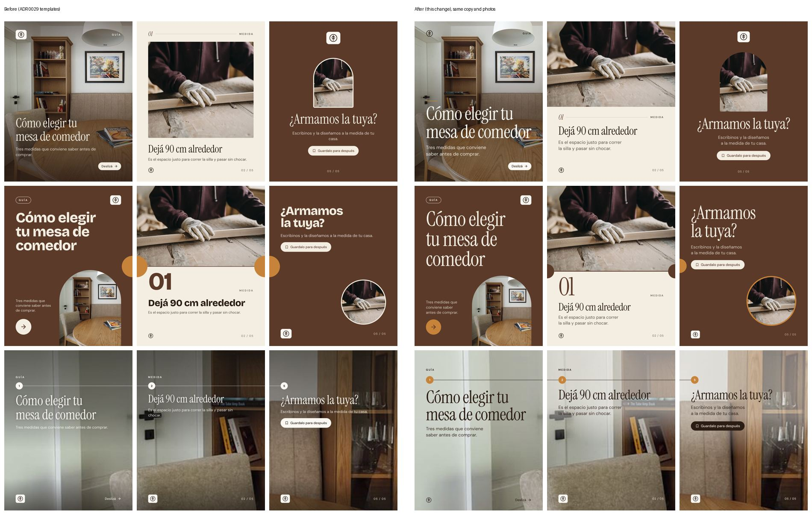
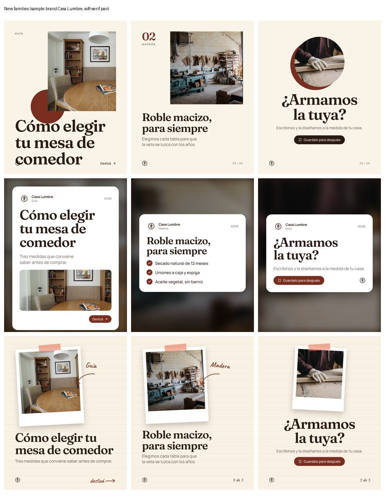

# Designer agent: what changed in the designs and how to compare models

The second pass on designed posts, after [recommendation.md](recommendation.md) and [ADR 0029](../../decisions/0029-designed-slides-ai-scene-code-layout.md). Decision: [ADR 0035](../../decisions/0035-art-director-design-rules-and-design-critic.md). Renders made on 2026-10-25 from the renderer's sample slides (`/dev/post-templates` with `ENABLE_TEMPLATE_PREVIEW=true`). The samples use stock photos of a furniture business and synthetic brands.

## Why the ADR 0029 slides still looked generic

Read from the renders and the code at `63ce265`:

- **Small, quiet type.** Body text at 28–34 px and headlines sized by character count, not by the space they had, so most slides used a fraction of the canvas. The renderer guidance in [design-patterns.md](design-patterns.md#slide-anatomy) asks for headlines of at least 72 px and body text of at least 32 px.
- **Every brand looked the same.** Fonts were fixed per family. The Brand Brain had five colors and no typography.
- **Text over busy photos.** The panorama's body text sat over shelves and books with a fixed gradient. Nothing measured the photo under the text.
- **No design judgment anywhere.** The Art Director chose one of three family names. Its prompt had no design rules, and no step looked at a rendered slide before the Owner did.

## What the change does

Same copy and photos, before and after (sample brand Taller Roble, `serif-classic` pair):



The three new families, with another sample brand (Casa Lumbre, `soft-serif` pair):



- **Type set to the space.** `fit()` in `frontend/lib/post-render/design.ts` measures each text block with Takumi's `measure()`. It takes the largest size that fits the slot's width and line limit, and sets the slot at its smallest size only when nothing fits, which the render report marks as `clamped`.
- **Legibility from the photo's own pixels.** The renderer reads the scene as a 72 × 90 grid of raw pixels, with no extra service. Under each text block it takes the 92nd percentile of brightness for light text, or the 8th for dark text, and the busiest patch. From those it picks the text color and the shade strength for 4.5:1 contrast (3:1 for large type), and it shades more over busy patches.
- **Brand font pairs**: `serif-classic` (Instrument Serif + DM Sans), `grotesk` (Bricolage Grotesque + DM Sans), `soft-serif` (Fraunces + Manrope), `condensed` (Anton + Inter), `geometric` (Manrope), `friendly-serif` (Young Serif + Inter). Caveat is used only for scrapbook's handwritten notes. All are OFL, and their license texts sit next to the files in `frontend/lib/post-render/fonts/`.
- **Layouts per role and knobs**, so two posts from the same family don't look identical. The full list is in [ADR 0035](../../decisions/0035-art-director-design-rules-and-design-critic.md).
- **A Design Critic** reviews every rendered carousel once before the Owner sees it.

## Comparing Art Director and critic models

`backend/app/posts/design_eval.py` runs fixed briefs (`backend/evals/design/cases.json`, with the synthetic brand in `brand.json`) through the whole pipeline: Art Director, image service, renderer and critic. For each case it saves the slides before the review (`draft-N.jpg` plus their render reports) and after it (`slide-N.jpg`). `compare` builds a blind A/B page of two runs, and the key to it goes in a separate file.

```bash
# frontend: RENDER_SECRET=<secret> npm run dev
cd backend
export RENDERER=takumi RENDERER_URL=http://localhost:3000 RENDERER_SECRET=<secret>
uv run python -m app.posts.design_eval run --label flash --out ../.design-eval
uv run python -m app.posts.design_eval run --label opus --art-director claude-opus-5-5 \
    --critic claude-opus-5-5 --out ../.design-eval
uv run python -m app.posts.design_eval compare ../.design-eval/flash ../.design-eval/opus \
    --out ../.design-eval/compare.html
```

A run costs one design call, one image per slide and one review per case: four cases, sixteen slides. Score each carousel from 1 to 5 before opening `key.json`.

## Not measured yet

- **No live run yet.** On 2026-10-25 the local `GEMINI_API_KEY` was rejected (`401 ACCESS_TOKEN_TYPE_UNSUPPORTED`), so nothing here was generated end to end. The first run with a valid key gives the baseline, and the Opus run gives the comparison ([open questions](../../open-questions.md#post-and-carousel-design)).
- How often the critic asks for fixes on real carousels, and whether its fixes are improvements (compare `draft-N.jpg` with `slide-N.jpg`).
- The extra latency and cost of the review on real posts: count the `design_critic` lines in the logs.
